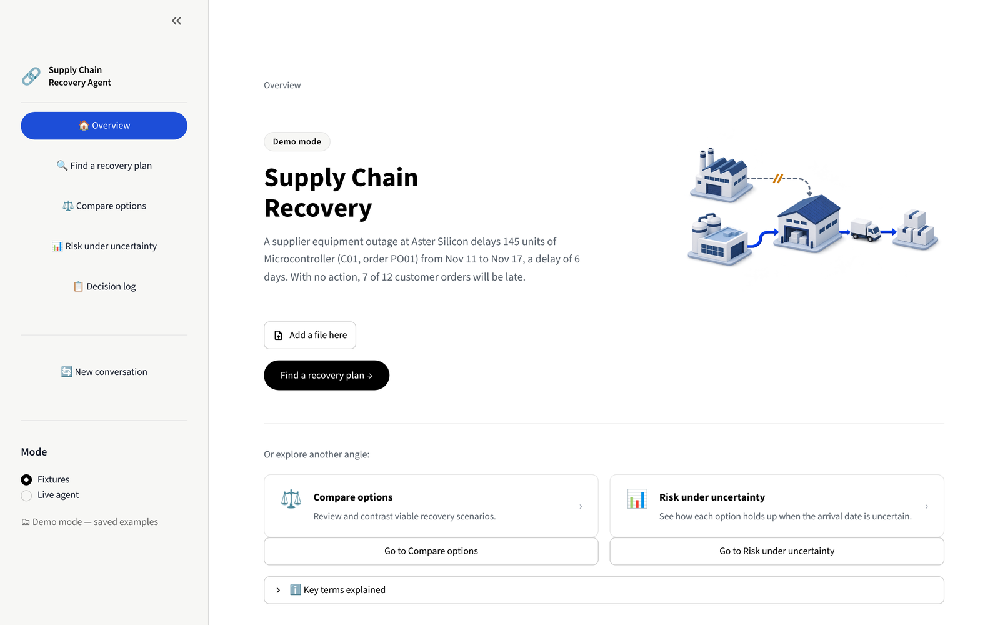
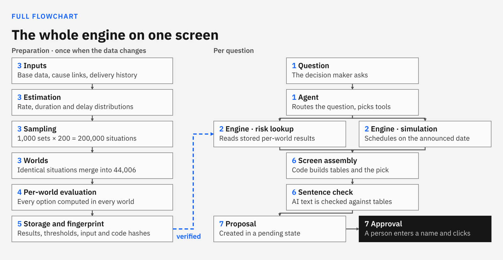
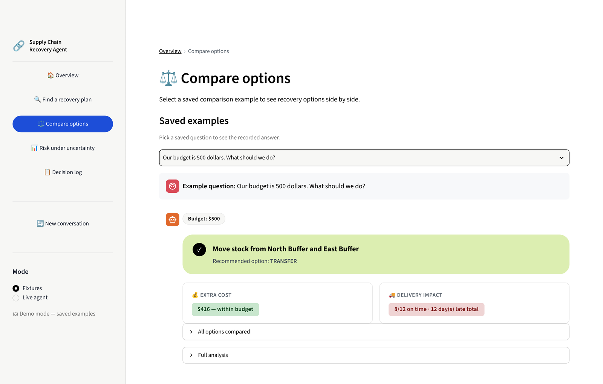
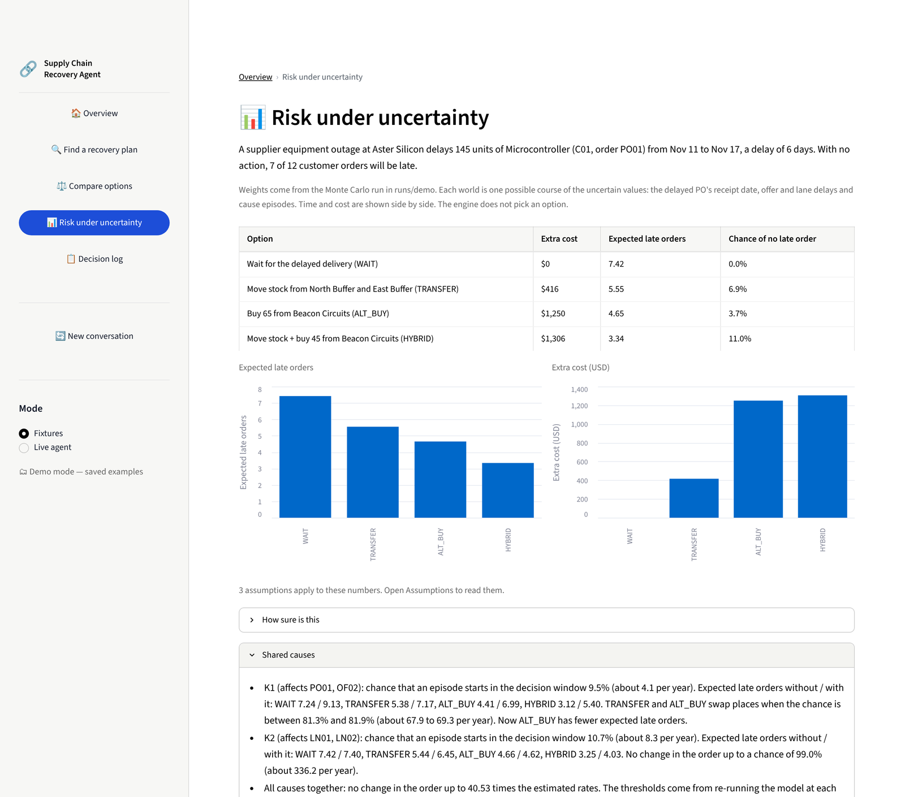
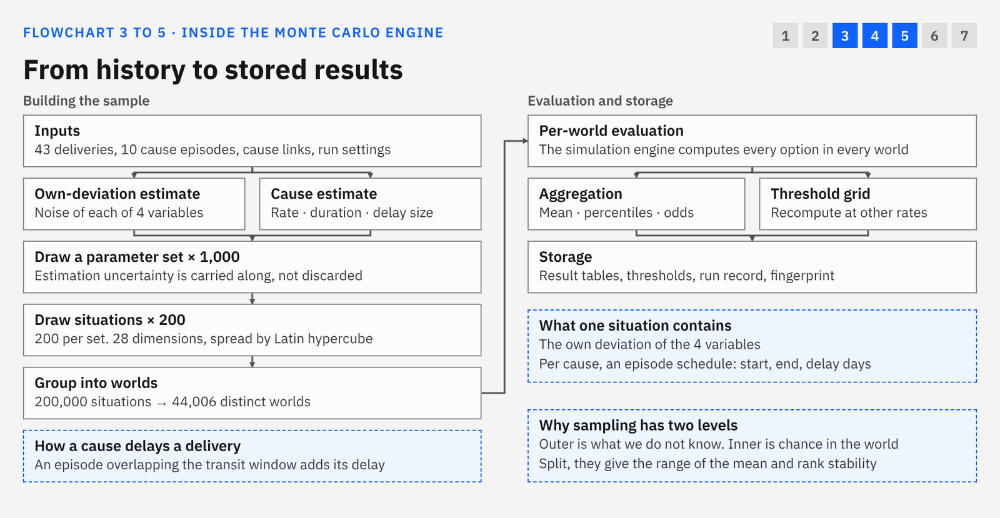

# Supply Chain Recovery Decision Agent

An AI agent that helps a manufacturing operations manager respond to a supplier disruption.
The manager asks questions in plain English.
The agent calls a deterministic simulation engine, compares recovery options, explains the trade-offs, and prepares a proposal.
A Monte Carlo engine shows how each option holds up when delivery dates are uncertain.
A human approves every action. The agent never approves or executes anything.

Team **Instant Bibimbab Masters**, IBM SkillsBuild AI Experiential Learning Lab.
Built with **IBM Bob** (development) and **IBM watsonx.ai** (LLM runtime).



**The engine computes the numbers. The AI explains. A person approves.**

---

## The problem in one paragraph

NovaTech, a fictional electronics manufacturer, learns on 2026-11-09 that purchase order PO01 (145 units of component C01) will arrive on 11-17 instead of 11-11. C01 goes into all three products, so 7 of 12 customer orders would be late if nothing is done. Recovery options include moving stock from two buffer warehouses and buying from an alternative supplier. The manager needs to know which option to choose under a budget, which customers are affected, and why specific orders stay late. All data is synthetic. See `reference/README.md` for the full scenario (Korean).

## Full design and demo scope

The full design starts from a delay notice that a manager types in plain words.
The demo starts after the notice has been parsed and judged.

```
 [Manager]  Delay notice in free text                             not in demo
                │
 [Agent]    Parse notice → event JSON                             not in demo
                │
 [Engine]   Response needed? ── no ──► [Agent] report "wait"      not in demo
                │ yes
 ───────── demo starts here: data/ holds the parsed event ─────────
                │
 [Engine]   Run calculation: shortages, at-risk orders,  ◄───┐
            options, evaluation, ranking                     │
                │                                            │ what-if
 [Agent]    Explain results and trade-offs in plain words    │ recalculate
                │                                            │
 [Manager]  Approve / reject, or ask what-if ────────────────┘
```

Two steps of the full design are not built in the demo.
The agent does not read a free-text notice.
The system does not decide whether a response is needed.

`data/` holds what those two steps would produce.
`disruptions.csv` and `purchase_orders.csv` contain the parsed event.
The other files hold the master data around it.
The data is synthetic.
It was written by hand so that the scenario is complete and every result can be checked.
`reference/verify.py` recomputes the scenarios independently of `engine/`.

A real notice rarely gives one certain date.
The supplier announced 11-17, but PO01 could arrive earlier or later.
The alternative supplier and the transfer lanes can be late too, and one cause can delay several of them together.
A Monte Carlo engine therefore evaluates every option in many possible worlds and reports the risk of each option.
How likely each world is comes from delivery history, not from the model.
See [Risk under uncertainty](#risk-under-uncertainty-monte-carlo-engine) below.

## How it works



The left column runs once whenever the data changes. It turns delivery history into stored results.
The right column runs for every question.
A question about one announced date goes to the simulation.
A question about uncertainty reads the stored results, after the fingerprint is verified.
Both paths meet where code builds the screen, pass the sentence check, and end with a proposal that a person approves.
The blue numbers group the boxes into seven parts: 1 question and agent, 2 simulation, 3 sampling, 4 per-world evaluation, 5 storage, 6 screen and sentence check, 7 proposal and approval.

```
 Manager question ──► agent/ (watsonx.ai LLM, tool calling)
                          │   chooses tools, never computes numbers
                          ▼
                     engine/tools.py (8 LLM tools + get_world_risk for code, deterministic)
                          │   simulation, comparison, search, explanations
                          ▼
                     agent/render.py builds the tables, agent/claims.py checks the model's text
                          │
                          ▼
                     answer with an options table + pending proposal
                          │
                          ▼
                     human approves in the UI (not the agent)
```

Design rules, enforced in code:

1. **The engine computes, the LLM explains.** Every number in an answer must come from a tool result. Counts, differences and explanations that matter (late orders, shortfalls, scope limits) are produced by the engine as fields or sentences, so the model copies them instead of calculating.
2. **Two phases per turn.** A gather phase lets the model call tools (at most 10 steps, duplicate calls are blocked). Then the answer is built.
3. **Fixed answer layouts, built by code.** For recommendations, comparisons, option descriptions, order explanations, proposals and unsupported questions, `agent/render.py` lays out the engine data the same way every time: a situation sentence, an options table with the same rows and columns, a ★ on the option that best meets the user's budget and objective, and a next step the user can say back (for example *"Propose TRANSFER"*). The ★ follows the user's own words (budget, target, objective), not the model's choice. The model writes only the 2 or 3 sentences of reasoning and the trade-offs. Other questions (impact, priority customers, general questions) get a free-text answer. Each result also carries a structured `view` that a UI can render directly.
4. **Proposals only on request, approval only by a human.** `propose_action` is offered, named in the prompt, and callable only when the user asks to act (approve, propose, implement, submit). When a proposal is created, the answer lists the option, its metrics and each action in plain language, with status `pending_approval`. Only the UI can turn a proposal into approved or rejected, through `agent/decisions.record_decision()`, which the model cannot call.
5. **Safe failure.** Unsupported questions (receipt dates after the simulated window, unknown disruptions, changes to other inputs) get a scope note from the engine instead of invented numbers. If watsonx.ai cannot be reached, the agent retries twice and then returns a message that contains no numbers. If only the reasoning step fails, the engine-built table and recommendation are still shown.
6. **Uncertainty without invented numbers.** Questions about risk or about another receipt date ("what if it is 3 days late?") are recognised by a rule in code, not by the model, and get the `world_risk` answer. Its tables come from the stored Monte Carlo run. The model writes one short paragraph. See `docs/decisions/0003-uncertain-date-in-agent-answers.md`.
7. **Every model sentence is checked against the table.** Code checks three things in the text the model writes: every number is in the table, every option named is in the table, and every comparison ("higher", "fewest", "3 fewer", "saves $416") points the right way for the values in the table (`agent/claims.py`). A sentence that is wrong, or that the code cannot read, is not shown, and the screen says that it was removed. The tables and the recommendation stay.
8. **A stored run is used only if it matches.** The Monte Carlo results are stored with a fingerprint: a SHA-256 hash of every input file, the run settings and every code file in `engine/` and `montecarlo/`. If anything changed, the agent refuses the old run and names the command that rebuilds it.
9. **Defensive argument handling.** String numbers and booleans (`"500"`, `"true"`) are coerced, `"null"` is treated as missing, unknown IDs and the disrupted supplier's offer are rejected with a message the model can act on.

## Quick start

Requirements: Python 3.11 or newer.

```bash
git clone https://github.com/Ian-Yoon3/IBM-Bibimbab.git
cd IBM-Bibimbab
pip install -r requirements.txt
python -m streamlit run app.py
```

The app opens in Fixtures mode. It shows saved answers from real agent runs and the Monte Carlo results, and needs no credentials.
The engine and all tests need no credentials either.

To talk to the live agent, copy `.env.example` to `.env` and fill in your watsonx.ai credentials. `.env` is gitignored. Never commit it.

```
WX_API_KEY=...
WX_PROJECT_ID=...
WX_URL=https://us-south.ml.cloud.ibm.com
WX_MODEL_ID=meta-llama/llama-3-3-70b-instruct
```

Run every command from the repository root. Scripts are run as modules (`python -m ...`) so that the `agent` and `engine` packages are found.

| Task | Command | Needs `.env` |
|---|---|---|
| Open the app | `python -m streamlit run app.py` | no (Fixtures mode) |
| Run the engine and agent tests (1,142) | `python -m unittest discover -s tests` | no |
| Run the UI tests (205) | `python -m unittest discover -s ui/tests` | no |
| Check that the stored Monte Carlo run matches the data and code | `python -m engine.runs --check` | no |
| Rebuild the Monte Carlo run (about 30 minutes on a laptop with the threshold grid) | `python -m montecarlo.run --data data --out runs/demo` | no |
| Engine walkthrough | `python demo.py` | no |
| Chat with the agent in the terminal | `python -m scripts.chat` | yes |
| Check the watsonx.ai connection | `python -m scripts.check_wx` | yes |
| Golden-question evaluation | `python -m scripts.eval_agent --runs 3` | yes |
| Realistic question sweep (answers saved for reading) | `python -m scripts.question_sweep` | yes |

Example questions:

```
Our budget is 500 dollars. What should we do?
Is there a cheaper way than HYBRID to keep 11 orders on time?
With that option, why is SO08 still late?
How risky is each option if the arrival date of PO01 is uncertain?
Propose that option.
```

## What the manager sees

The app has five screens, in the order a manager asks.

| Screen | Question it answers |
|---|---|
| Overview | What happened? |
| Find a recovery plan | What is advised for my budget? Create a proposal and approve it |
| Compare options | What can be done? |
| Risk under uncertainty | What if the arrival date is uncertain? |
| Decision log | Who approved what? |

A recommendation for a budget of $500. The summary comes first. The full comparison table and the analysis open on request.



The same answer in full, from the run in `eval_results/sweep_20261122_111825.json`.
The table, the ★, the late-order line and the next step are built by code from the engine; the italic parts are written by the model and checked against the table.

> **Situation**
> A supplier equipment outage at Aster Silicon delays 145 units of Microcontroller (C01, order PO01) from Nov 11 to Nov 17, a delay of 6 days. With no action, 7 of 12 customer orders will be late.
>
> | Option | On-time orders | Priority-1 on time | Total days late | Extra cost | Within $500 |
> |---|---|---|---|---|---|
> | Wait for the delayed delivery (WAIT) | 5 of 12 | 2 of 6 | 27 | $0 | yes |
> | **Move stock from North Buffer and East Buffer (TRANSFER) ★** | **8 of 12** | **4 of 6** | **12** | **$416** | **yes** |
> | Buy 65 from Beacon Circuits (ALT_BUY) | 9 of 12 | 4 of 6 | 5 | $1,250 | no |
> | Move stock + buy 45 from Beacon Circuits (HYBRID) | 11 of 12 | 5 of 6 | 2 | $1,306 | no |
> | Move stock + buy 35 from Beacon Circuits (OF02 x35 + transfers, found by search) | 10 of 12 | 5 of 6 | 4 | $1,126 | no |
> | Move stock + buy 40 from Beacon Circuits (OF02 x40 + transfers, found by search) | 11 of 12 | 5 of 6 | 2 | $1,216 | no |
> | Move stock + buy 65 from Beacon Circuits (OF02 x65 + transfers, found by search) | 12 of 12 | 6 of 6 | 0 | $1,666 | no |
>
> **Recommendation:** Move stock from North Buffer and East Buffer (TRANSFER). *The engine recommends TRANSFER, which has the most on-time orders within the budget. TRANSFER has more on-time orders than WAIT. TRANSFER also has the lowest extra cost among options with at least 8 on-time orders.*
>
> **Trade-offs and risks:** Still late with this option: SO05 (5 days), SO06 (3 days, priority 1), SO07 (2 days), SO08 (2 days, priority 1). *ALT_BUY would increase extra cost to $1,250 and reduce total days late to 5. HYBRID would increase extra cost to $1,306 and reduce total days late to 2.*
>
> **Next step:** To act on this, say *"Propose TRANSFER"*. Nothing is executed until it is approved in the UI.


A proposal is created only when the manager asks for one. It becomes approved or rejected only when a person enters a name and clicks the button. The Decision log keeps the person, the time, the action and the cost.

The "Add a file here" button on the first screen shows the data files in use and the state of the Monte Carlo run. Upload is switched off, because new data needs a new Monte Carlo run.

## Risk under uncertainty (Monte Carlo engine)



The single-date table assumes that PO01 arrives on the announced date and that every other delivery is on time.
The Monte Carlo engine drops that assumption. The design, the equations and the verification are in [`docs/montecarlo-engine.md`](docs/montecarlo-engine.md).



- **Four uncertain values.** The receipt date of PO01, the lead time of the alternative offer OF02, and the transit times of the two transfer lanes LN01 and LN02. Demand, stock and production are fixed.
- **Two shared causes.** K1 (port congestion) delays PO01 and OF02 together. K2 (regional transport disruption) delays both lanes together. Each value is its own deviation plus the delay from a cause. Which value is tied to which cause is written in `data/causes.csv`. This is the common shock model of Marshall and Olkin (1967), the founding paper of that model and a standard in reliability texts.
- **Estimation from history.** `data/history/` holds 43 deliveries and 10 cause episodes. Rate, duration and delay size of each cause are estimated with conjugate Bayesian models (Gelman et al., *Bayesian Data Analysis*, 3rd ed., the standard textbook of the field). The history is short, so the estimate is not fixed at one value.
- **Two-level sampling.** The engine draws 1,000 parameter sets from the estimate and 200 situations for each set, with Latin hypercube sampling (McKay, Beckman and Conover, 1979, the paper that introduced the method). The outer level is what we do not know. The inner level is chance. The 200,000 situations group into 44,006 distinct worlds, each with a weight.
- **Exact evaluation.** The simulation engine computes every option in every world. Sampling decides how often a situation occurs. The simulation decides how many orders are late in it.
- **Stored and fingerprinted.** One run is kept whole in `runs/demo/` with its seed (20261109) and settings. `python -m engine.runs --check` confirms that inputs, code and outputs match.

Results of the run in `runs/demo`:

| Option | Extra cost | Expected late orders | Range of the mean | 90th percentile | Mean of worst 10% | Chance of no late order |
|---|---:|---:|---:|---:|---:|---:|
| WAIT | $0 | 7.42 | 6.26 to 8.38 | 10 | 10.88 | 0.0% |
| TRANSFER | $416 | 5.55 | 4.52 to 6.45 | 9 | 9.59 | 6.9% |
| ALT_BUY | $1,250 | 4.65 | 3.64 to 5.80 | 8 | 9.50 | 3.7% |
| HYBRID | $1,306 | 3.34 | 2.51 to 4.25 | 7 | 7.98 | 11.0% |

ALT_BUY has fewer expected late orders than TRANSFER but a lower chance of no late order. The measures disagree, so the engine does not pick a winner. Time and cost are shown side by side and never combined.
The ranking by expected late orders is the same in 957 of the 1,000 parameter sets. In the other 43, TRANSFER and ALT_BUY swap.

Expected late orders without and with an episode of each cause:

| Option | Without K1 | With K1 | Without K2 | With K2 |
|---|---:|---:|---:|---:|
| WAIT | 7.24 | 9.13 | 7.42 | 7.40 |
| TRANSFER | 5.38 | 7.17 | 5.44 | 6.45 |
| ALT_BUY | 4.41 | 6.99 | 4.66 | 4.62 |
| HYBRID | 3.12 | 5.40 | 3.25 | 4.03 |

With port congestion, ALT_BUY loses most of its advantage over TRANSFER, because the alternative supplier ships through the same port. Regional transport disruption touches only the options that move stock.

The estimated rates may be wrong, so the engine also recomputes everything at other rates, with the same random numbers.
TRANSFER and ALT_BUY swap only when K1 reaches about 68 to 69 episodes per year. The estimate is 4.1 per year.
For K2 the ranking holds up to 336 per year. With every rate multiplied together, it holds up to 40.5 times the estimate.

## Engine tools (`engine/tools.py`)

These eight tools are offered to the LLM. `run_scenario`, `get_scenario_actions`, `get_catalog` and `get_world_risk` are used by the code (tests, `agent/render.py`) but are not offered to the model. `get_world_risk(disruption_id)` returns the results of the selected Monte Carlo run described above.

| Tool | What it returns |
|---|---|
| `get_disruption(disruption_id)` | Affected PO, component, dates, delay in days, and a `scope_note` stating what is modelled |
| `get_offers(disruption_id)` | Supplier offers for the affected component, with `is_disrupted_supplier` |
| `get_impact(disruption_id)` | What happens with no action: first late order, late order count, daily C01 shortage |
| `compare_scenarios(budget, objective)` | The four named options ranked, with NORMAL as the undisrupted baseline |
| `get_priority_view(scenario_id \| offer_id+qty+include_transfers)` | Priority-1 orders on time and late for one option |
| `get_order_detail(order_id, option)` | Why one order is late: blocked in the production queue or short of a component, with quantities and a one-sentence `summary` |
| `explore_purchase_qty(offer_id, include_transfers, budget, objective, min_on_time_orders)` | Every valid purchase quantity simulated and ranked. Finds options outside the four named scenarios |
| `propose_action(scenario_id \| offer_id+qty+include_transfers, reason)` | A proposal with metrics and status `pending_approval`. Nothing is executed |

The four named options for disruption D01:

| Option | On-time orders of 12 | Priority-1 on time of 6 | Extra cost USD |
|---|---:|---:|---:|
| WAIT | 5 | 2 | 0 |
| TRANSFER | 8 | 4 | 416 |
| ALT_BUY | 9 | 4 | 1,250 |
| HYBRID | 11 | 5 | 1,306 |

The search finds two options that are not in this list. Transfers plus 40 units from OF02 keep 11 orders on time for 1,216 USD, which is 90 USD less than HYBRID. Transfers plus 65 units keep all 12 orders on time for 1,666 USD.

## Evaluation

`scripts/eval_agent.py` asks 13 golden questions with known answers, each in a fresh conversation, and saves full transcripts to `eval_results/`. A question passes only if:

- the expected tool was called with the expected arguments,
- the key facts appear in the answer,
- every value in the options table matches the engine for that option and column,
- every number, date and ID in the answer appears in a tool result (grounding),
- no proposal was created unless the user asked for one.

The questions cover recommendations under a budget and under another objective, impact, priority customers, the cheaper option found by search, an unsupported hypothetical, approval, order-level explanations, and two multi-turn follow-ups.

Latest results with model `meta-llama/llama-3-3-70b-instruct`:

| Check | File | Result |
|---|---|---|
| 13 golden questions, 1 run, fixed answer layouts | `eval_results/20261107_235717.json` | **13 of 13 passed** |
| 13 golden questions, 3 runs, before the fixed layouts | `eval_results/20261107_220100.json` | 12 of 13 passed every run. Q13 repeated the previous answer in 2 runs, which the fixed order layout removes |
| 19 realistic conversations, 22 answers, read by hand | `eval_results/sweep_20261107_235511.json` | No table mismatch, no ungrounded number, every ★ and proposal matched the request |

The sweep (`python -m scripts.question_sweep`) found problems that the golden questions did not: the recommended option once followed the model's choice of objective instead of the user's budget, and a few question types had no fitting layout. Both were fixed before the latest runs.

Stage 1 added two more sweeps with the same model:

| Check | File | Result |
|---|---|---|
| 25 conversations, 28 answers, first world_risk prompt | `eval_results/sweep_20261112_015014.json` | No flagged answer. One paragraph named the late orders on one date "expected late orders". One correct paragraph was dropped because the stated budget was not shown. Both were fixed |
| Same questions, revised prompt | `eval_results/sweep_20261112_020142.json` | No flagged answer, no dropped paragraph, every number in the world_risk paragraphs carries the right column name. Source of `ui_fixtures/` |

The golden question Q5 ("What if the delay becomes 8 days?") now expects the `world_risk` answer for Nov 19 instead of a refusal. After stage 1 the golden evaluation was run again: `eval_results/20261112_021518.json`, **13 of 13 passed**. Q5 called only `get_disruption`, read the question as Nov 19 and quoted the "Late if it arrives Nov 19" column.

Stage 2 added a third sweep on 2026-11-22, after the Monte Carlo engine and the comparison check were in place:

| Check | File | Result |
|---|---|---|
| 25 conversations, 28 answers, Monte Carlo run `runs/demo` | `eval_results/sweep_20261122_111825.json` | No table mismatch, no ungrounded number, no error. The check removed the model's explanation in one answer. Source of `ui_fixtures/` |

The sentence that was removed is the reason the comparison check exists. An earlier run on the same day produced "TRANSFER costs $416 less than HYBRID". The number $416 is in the table, so the number check passed. The real difference is $890.

The default model was chosen with this evaluation. See `docs/decisions/0001-default-llm-model.md`.

## Known limitations

- The delivery history is synthetic. The method applies to real records as it is. Until then the Monte Carlo numbers are examples.
- File upload is not connected. New data needs a new Monte Carlo run, which takes about 30 minutes on a laptop with the threshold grid.
- Which deliveries share a cause is an assumption that a person writes in `data/causes.csv`. The two causes are assumed independent of each other.
- Only disruption D01 is modelled. Other disruptions and changes to other inputs are not, and the agent says so.
- Whether a question gets the `world_risk` answer is decided by its wording. A question phrased in an unexpected way can miss it and get a free-text answer. It does not get wrong numbers.
- The sentence check reads a fixed list of comparison phrases. A comparison worded outside the list can pass. A correct number given the wrong column name can also pass.
- The model sometimes skips the purchase-quantity search. The recommendation is then correct within the table but can miss a better combination.
- `get_impact` (impact with no action) still reports the announced date only.
- Question types without a fixed layout (impact, priority questions, general questions) are still written freely by the model, so their wording varies.
- `ibm/granite-4-h-small` can be selected but is not recommended. It wrote numbers that no tool returned in several runs (see ADR 0001).

## Model assumptions

These simplifications hold in every result the engine returns.

1. **No daily production capacity.** An order starts on the first day all its components are available. Several orders can start on the same day. Long delays are therefore shown shorter than they would be with a capacity limit.
2. **Fixed production queue.** Orders start in order of due date, then priority, then order ID. If the next order cannot start, later orders wait even when their own components are available.
3. **Four uncertain values, two shared causes.** Only the receipt date of PO01, the lead time of OF02 and the transit times of LN01 and LN02 vary. Demand, stock and production do not.
4. **All recovery actions are decided and executed on 11-09.** No option waits for more information before acting.
5. **Dates come from the data.** The decision day is the reported date of the disruption (11-09). The order horizon is the latest due date (11-21). See `docs/montecarlo-engine.md`, section 4.7.
6. **Extra cost does not depend on the world.** A late delivery changes the dates, not the price.

## Repository layout

```
IBM-Bibimbab/
├── app.py                Streamlit app: the five screens
├── ui/                   Renderers, saved-answer loading, session state, UI tests
├── data/                 14 CSV input files, causes.csv, history/ (all synthetic)
├── engine/               Deterministic simulation engine, stdlib only
│   ├── loader.py         Load and validate the CSVs
│   ├── simulate.py       Day-by-day simulation of an action list
│   ├── evaluate.py       KPIs per simulation
│   ├── candidates.py     Transferable quantities, valid purchase quantities
│   ├── analysis.py       Impact, priority view, marginal cost
│   ├── compare.py        Ranking by objective and budget
│   ├── worlds.py         Every option over weighted worlds
│   ├── runs.py           Run folders, fingerprint, run selection
│   └── tools.py          The API used by the agent
├── montecarlo/           Monte Carlo engine, separate from engine/
│   ├── estimate.py       Conjugate Bayesian estimates from history
│   ├── sample.py         Two-level Latin hypercube sampling
│   ├── grid.py           Threshold grid: recompute at other cause rates
│   └── run.py            One command: estimate, sample, evaluate, store
├── runs/demo/            The stored run: results, thresholds, run record, fingerprint
├── agent/                LLM layer (ibm-watsonx-ai)
│   ├── llm.py            watsonx.ai client, retries, argument normalisation
│   ├── tool_specs.py     Tool schemas, argument checks, dispatch
│   ├── prompts.py        System prompt, evidence playbook, answer formats
│   ├── loop.py           run_agent(): gather phase, answer phase, guards
│   ├── render.py         Fixed answer layouts built from engine data
│   ├── claims.py         Checks comparisons in the model's text against the table
│   ├── overview.py       First screen and data overview without an LLM call
│   ├── decisions.py      Human approve/reject log, called only by the UI
│   └── fake_llm.py       Scripted LLM for offline tests
├── scripts/              chat.py, eval_agent.py, question_sweep.py, check_wx.py, make_ui_fixtures.py
├── tests/                Engine, Monte Carlo and agent tests (no network)
├── eval_results/         Saved evaluation transcripts
├── ui_fixtures/          Real agent results shown in Fixtures mode
├── docs/                 montecarlo-engine.md, ui-contract.md, extension-plan.md, decisions/ (ADRs), images/
├── reference/            Original reference implementation and data dictionary
├── demo.py               Engine-only walkthrough of the tools
└── bob_sessions/         IBM Bob session records per team member
```

Team members: see `CONTRIBUTING.md` for branches, ownership and key rules, and `docs/ui-contract.md` for the UI.

## How IBM Bob was used

`AGENTS.md` and `.bob/` hold the project rules Bob reads before every task.
Each team member's Bob record is in `bob_sessions/<name>/`.
The expected values of each step were computed first, independently of the engine. Code written by Bob was accepted only when it matched them.
Commits whose code was written outside Bob say so in the commit message.

| Team member | Scope | Record |
|---|---|---|
| Junseo (Dennis) Choi | Calculation engine: `engine/`, engine tests, `demo.py`, `AGENTS.md` and `.bob/` rules | [bob_sessions/dennis](bob_sessions/dennis/README.md) |
| Jonghyun (John) Moon | Synthetic baseline: the 14 linked input files in `data/`, `reference/`, expected results in `tests/expected/` | [bob_sessions/jonghyun](bob_sessions/jonghyun/README.md) |
| Hyunsoo (Soo) Kim | UI: `app.py`, `ui/`, saved-answer mode, visual theme | [bob_sessions/hyunsoo](bob_sessions/hyunsoo/README.md) |
| Sunghyuk (Ian) Yoon | Agent layer: watsonx.ai connection, `agent/`, engine tool additions, evaluation harness. Uncertainty extension: worlds, Monte Carlo engine in `montecarlo/`, run fingerprint, `world_risk` answers, sentence checks. Connection of the UI to the stage 2 engine | [bob_sessions/ian](bob_sessions/ian/README.md) |

Work done outside Bob is stated in each record.
