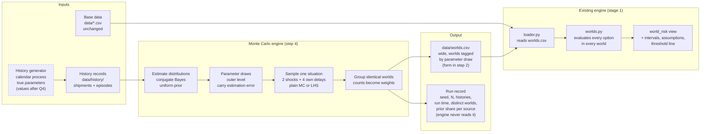

# Monte Carlo engine (stage 2) design

- **Status:** Living document. Step 1 (model design) is in progress. Each open question below is replaced by its decision when it is settled.
- **Branch:** `feature/extension-stage2-ian`, created from `feature/extension-trial-ian` at 34a7f78.
- **Decision owner:** Sunghyuk (Ian) Yoon
- **Last updated:** 2026-11-13

## 1. Purpose

Stage 1 gave the receipt date of PO01 fixed weights from a triangular rule (ADR 0002).
Stage 2 replaces those weights with a Monte Carlo engine.
The engine samples possible situations, groups identical ones and writes them as weighted worlds.
The existing engine evaluates every option in every world exactly, as in stage 1.

The engine exists for one reason.
A single cause can delay several things at once.
If port or customs congestion delays PO01, it can delay the alternative supplier OF02 too.
ALT_BUY is then late exactly when it is needed.
Fixed weights on one variable cannot show this. A joint model of several variables can.

This document holds the structure, the equations, the decisions so far, the open questions and the references.

## 2. How we got here

| Date | Decision | Where it is recorded |
|---|---|---|
| 2026-09-28 | The main project is the supply chain recovery decision agent. Monte Carlo becomes a side track that is added once the main project works. | Team discussion |
| 2026-11-07 | Engine MVP on the team baseline data. `simulate()` takes a list of actions, not a scenario name. Results are checked against precomputed answers in `tests/expected/`. | `README.md`, commit history on `main` |
| 2026-11-09 | Extension plan in three stages. (1) Uncertain receipt date as data. (2) Monte Carlo creates the worlds. (3) Model refinement. | `docs/extension-plan.md` |
| 2026-11-09 | Design rules. The engine computes exactly where it can. Monte Carlo is used only where things cannot be counted. Time and cost are never merged into one score. The LLM never sets weights. | `docs/extension-plan.md` |
| 2026-11-11 | Stage 1 weights are integers from a triangular three-point estimate. | ADR 0002 |
| 2026-11-12 | Stage 1 answers use a code-built `world_risk` view with one checked LLM paragraph. | ADR 0003 |
| 2026-11-12 | Stage 1 is complete and frozen for team review (476 tests). Stage 2 starts on its own branch. | `docs/extension-plan.md` |
| 2026-11-12 | Monte Carlo output is one wide CSV. `world_overrides.csv` goes away. | Section 5, ADR 0004 (step 2) |
| 2026-11-12 | Three kinds of variables, so that shared causes exist. PO01 receipt date, OF02 lead time, transfer lane lead times. | Section 4.1 |
| 2026-11-12 | "More realistic" means limited history. Few records per source, synthetic but plausible. | Section 6 |
| 2026-11-12 | No neural acceleration in stage 2. | Section 5 |
| 2026-11-12 | Plain Monte Carlo, common random numbers and Latin hypercube sampling. Every summary number gets a standard error. | Section 5 |
| 2026-11-12 | Scale is split off as optional stage 2-1. | Section 8 |
| 2026-11-12 | Two shared causes (option B). Gateway congestion moves PO01 and OF02. Regional transport disruption moves LN01 and LN02. | Section 4.2 |
| 2026-11-12 | Shared causes are modelled as common shocks with a shared severity, not as a copula. | Sections 4.3 and 4.5 |
| 2026-11-12 | Shared causes are recorded in the history as episodes. Two history files under `data/history/`. | Section 6.1 |
| 2026-11-12 | History is generated as a calendar process that is richer than the estimator. One demo history is committed. The method is checked over many generated histories. | Sections 6.3 and 6.4 |
| 2026-11-13 | `worlds.csv` carries a `draw` column. Every draw has the same total weight. | ADR 0004 |
| 2026-11-13 | Estimation is Bayesian with conjugate priors and a uniform prior. Chosen by comparing six established methods on the engine itself. | Section 7 |
| 2026-11-13 | Parameter uncertainty enters by two-level sampling. Every summary number gets an interval. | Section 7.2 |
| 2026-11-13 | The view states the model assumptions and one threshold line per shared cause. No fixed stress scenario. | Section 7.6 |
| 2026-11-14 | Every date comes from the data. No date is fixed in code. | Section 4.7 |
| 2026-11-14 | Gateway inputs move on business days of the real calendar, US federal holidays computed for any year, with an optional closed-days file. | Section 4.7 |
| 2026-11-14 | Exposure period of each cause comes from the data. A cause already active on the decision day is certain. | Section 4.7 |
| 2026-11-14 | Opening the offer and lane kinds moves before the Monte Carlo engine, so the engine can write all four variables. | Section 9 |
| 2026-11-14 | An offer arrives at its promised date (order date plus the calendar lead time) moved by a deviation in business days. The world stores the deviation, and the simulator converts it at the actual order date. | Section 4.7 |
| 2026-11-14 | Latin hypercube sampling is the default inside each parameter draw. Plain Monte Carlo stays as an option for comparison and verification. | Section 5 |
| 2026-11-14 | M = 1000 parameter draws, N = 200 worlds per draw, error targets, coverage check over 200 histories, evaluation cached per distinct world. | Section 5 |
| 2026-11-15 | The Monte Carlo engine writes its output to `runs/<name>/`, never into `data/`. `data/worlds.csv` keeps the stage 1 worlds until one deliberate switch in step 6. | Section 9 |
| 2026-11-15 | Which variable each cause can hit, and in which day unit, is data (`data/history/causes.csv`). | Section 6.1 |
| 2026-11-14 | The threshold line uses a closed form. Each world carries a 0/1 tag per cause. | Section 7.6 |
| 2026-11-14 | The true parameters of the synthetic world are fixed before any result is seen. | Section 6.3 |
| 2026-11-15 | The engine must run on any data set in the schema, not only on the demo. A fixed set of variant data sets checks this in the tests. | Section 10 |
| 2026-11-15 | The history states its observation period (`data/history/period.csv`). The episode rate uses that length, not a fixed year. | Sections 6.1 and 7.1 |
| 2026-11-15 | A sampled value beyond the one-year cap is cut there for every kind of variable, offers included, and counted. | Section 4.7 |
| 2026-11-15 | The demo history comes from the same model family as the estimator. Checks on it verify the code, not the fit to real data. | Section 7.4 |
| 2026-11-18 | A shipment not yet received on the decision day is left out of the generated history, as in real records. | Section 6.3 |
| 2026-11-18 | Exposure to a shared cause follows the overlap rule of the history format at the actual transit of each order. The worlds carry an episode timeline per cause. Built with Bob in step 6 (Q6). | Section 8 |
| 2026-11-17 | $M$ stays at 1000 although one error target is missed (lower interval end of WAIT, 0.061 against 0.05). The evaluation is not yet simplified, so more draws cost waiting time on every question. $M = 1600$ follows once it is. | Sections 5 and 9 |

## 3. Structure

Solid boxes are decided. Dashed boxes are open and name the question that settles them.

Two separate functions are kept on purpose.
"Make samples" and "evaluate one world" never share code.
Stage 2-1 can then swap the sampler or add an estimator without touching stage 2.
No code assumes that samples collapse into few worlds. Collapsing is an optimisation only.

The simulation window is defined in one place (step 3). Its end is set by Q4.

## 4. Model

### 4.1 Uncertain variables

| Symbol | Variable | Base value | Column in `worlds.csv` |
|---|---|---|---|
| $R$ | Receipt date of PO01 | Announced 2026-11-17 (planned 2026-11-11) | `purchase_order.PO01.receipt_date` |
| $L_O$ | Lead time of offer OF02 (S02, C01) | 3 days | `offer.OF02.lead_days` |
| $L_1$ | Lead time of lane LN01 (WH02 to WH01) | 2 days | `lane.LN01.lead_days` |
| $L_2$ | Lead time of lane LN02 (WH03 to WH01) | 4 days | `lane.LN02.lead_days` |

All values are whole days.
Every other value in the base data stays fixed.

### 4.2 Shared causes

| Cause | Moves | Story |
|---|---|---|
| $K_1$ Gateway congestion | $R$, $L_O$ | Port or customs backlog at the import gateway that both C01 suppliers use |
| $K_2$ Regional transport disruption | $L_1$, $L_2$ | Weather or a carrier shortage on the roads into WH01 |

The two causes are independent of each other.
A storm that triggers both is left as future work.

**Assumptions** (stated in the README when stage 2 ships)

1. S01 and S02 bring C01 in through the same import gateway.
2. One congestion episode covers the whole window, so OF02 (shipped 11-09) and PO01 (shipped after the repair) see the same backlog.
3. The announced date 11-17 reflects the equipment repair only. Gateway congestion comes on top of it.
4. Congestion and transport disruptions are recorded when they happen. Import shipments carry customs clearance times and carriers report delay reason codes, so this is not an artificial assumption.
5. A revised date announced after the repair is kept about as well as S01's ordinary promised dates. The own delay $E_R$ is estimated from S01's promise errors.

### 4.3 Equations

Each cause $k \in \{1, 2\}$ is a common shock.

$$S_k \sim \text{Bernoulli}(p_k), \qquad C_k \in \{1, 2, \dots\} \text{ with probability mass function } g_k$$

$S_k = 1$ means the cause occurs. $C_k$ is its severity in days.
Every variable exposed to cause $k$ is delayed by the same $S_k C_k$ days.
This is the shared severity. The same backlog delays everything that passes through it.

Each variable also has its own delay $E$ that no other variable shares.

$$
\begin{aligned}
R   &= d_{\text{ann}} + E_R + S_1 C_1 \\
L_O &= 3 + E_O + S_1 C_1 \\
L_1 &= 2 + E_1 + S_2 C_2 \\
L_2 &= 4 + E_2 + S_2 C_2
\end{aligned}
$$

$d_{\text{ann}}$ is the announced date 2026-11-17.
$E_R, E_O, E_1, E_2, S_1, C_1, S_2, C_2$ are mutually independent.
Their distributions are estimated from history (Q2, Q3).
Constraints from the base data still hold. $R$ is never before the planned date 11-11. Lead times stay at least 1 day.
Whether shipments skip weekends and holidays is decided in Q4.

One situation therefore needs eight random inputs.
With LHS each input gets its own stratified column.

### 4.4 Properties used in verification

**Covariance.** For two variables exposed to the same cause $k$,

$$\mathrm{Cov} = \mathrm{Var}(S_k C_k) = p_k \mathbb{E}[C_k^2] - p_k^2 \mathbb{E}[C_k]^2 .$$

Variables exposed to different causes have covariance zero.
Step 5 checks the sampled covariance against this value.

**Conditional probability.** $P(L_O \ge \ell \mid R \ge r)$ is a finite sum over $S_1$, $C_1$, $E_R$ and $E_O$.
It is computed exactly and compared with the sampled share.

**Special cases.**
$p_2 = 0$ gives option A (one cause only).
$p_1 = p_2 = 0$ gives independent variables, whose joint distribution is an exact convolution.
These are the known answers for step 5.
They are also the fallback. If the second cause cannot be estimated well, stage 2 ships with $p_2 = 0$ and states it.

### 4.5 Why a common shock and not a copula

Two ways to make the variables move together were compared.
A Gaussian copula ties the variables with one correlation $\rho$.
A common shock names the cause and adds its delay.

| Criterion | Common shock, shared severity | Gaussian copula |
|---|---|---|
| Joint delay in the extreme tail | Kept | Vanishes |
| Meaning of the parameters | "Congestion comes with probability $p$ and adds $C$ days" | $\rho$ has no direct physical meaning |
| Estimation from tens of records | $p$ and $C$ are estimated separately when the congestion state is recorded | 30 pairs with $\rho = 0.3$ give a 95% interval of about −0.07 to 0.60 (Fisher $z$) |
| Whole-day variables | No problem | Copula is not unique for discrete margins |
| Verification | Hand calculation and exact sums | Numerical integration |
| Advantage | Cause is explicit | Works without knowing the cause |

The tail row decides the matter.
A Gaussian copula with $|\rho| < 1$ has zero tail dependence (Embrechts, McNeil and Straumann 2002).
It therefore understates the case where everything is late together, which is the case this engine exists to show.

Illustration. Two continuous delays, each own delay exponential with mean 1, shock probability 0.2, shock severity exponential with mean 3. Both models have the same marginals and the same Spearman rank correlation. 2,000,000 samples, computed outside the repository.

| Top share $q$ | Common shock, severity drawn separately | Common shock, severity shared | Gaussian copula |
|---|---|---|---|
| 10% | 0.34 | 0.68 | 0.21 to 0.24 |
| 1% | 0.05 | 0.80 | 0.05 to 0.07 |
| 0.1% | 0.00 | 0.80 | 0.01 to 0.02 |

Each cell is the probability that one delay is in its top $q$ given that the other one is.
Drawing a separate severity per variable loses the tail just as the copula does.
That is why severity is shared.

### 4.6 What the shared cause changes in the results

Late orders per receipt date of PO01 and lead time of OF02, current engine at 34a7f78.

| ALT_BUY, OF02 lead | 11 | 12 | 13 | 14 | 15 | 16 | 17 | 18 | 19 | 20 | 21 |
|---|---|---|---|---|---|---|---|---|---|---|---|
| 3 days (stage 1) | 0 | 1 | 1 | 1 | 1 | 3 | 3 | 4 | 6 | 6 | 7 |
| 4 days | 0 | 1 | 3 | 3 | 3 | 5 | 5 | 6 | 8 | 8 | 9 |
| 5 days | 0 | 1 | 3 | 4 | 4 | 6 | 6 | 7 | 9 | 9 | 10 |
| 6 days | 0 | 1 | 3 | 4 | 5 | 7 | 7 | 8 | 10 | 10 | 11 |

One extra day for OF02 removes most of the gain of ALT_BUY.
At 6 days ALT_BUY equals WAIT.
WAIT and TRANSFER do not depend on OF02.

Late orders react almost additively to the two delays.
The expected value of a sum does not depend on how the parts are correlated.
So the shared cause barely moves expected late orders. It moves the tail and the conditional numbers.

Illustration with assumed parameters (not proposals). PO01 triangular with peak 11-16 without congestion and 11-19 with it, congestion probability 0.3, OF02 lead 3 or 4 days without congestion and 3 to 5 days with it. Same marginals in both columns.

| | Independent | Common shock |
|---|---|---|
| ALT_BUY expected late orders | 3.75 | 3.76 |
| ALT_BUY 90th percentile | 6 | 7 |
| HYBRID 90th percentile | 4 | 5 |
| P(OF02 at least 4 days given PO01 on or after 11-17) | 0.345 | 0.403 |

Consequence for the view (step 6). Expected values alone would hide the shared cause.
The view must show the 90th percentile and the conditional probability next to them.
With OF02 uncertain, ALT_BUY and TRANSFER come close in expected late orders (3.75 and 3.71 above), so the ranking itself can change.

### 4.7 Dates and calendar

**Every date comes from the data.** No date is fixed in code, so another data set works without changes.

| Date | Rule | Value for the current data |
|---|---|---|
| Decision day | The reported date of the disruptions. All disruptions of a data set share it. | 2026-11-09 |
| Order horizon | The latest due date in `orders.csv`. Late orders are judged against due dates, and user-facing tables run to this day. | 2026-11-21 |
| Simulation end | The latest date the data can schedule (planned and revised receipts, recovery receipts, a purchase on the decision day at the longest lead time, dates in `worlds.csv`) plus the longest production time | 2026-11-23 |
| Sampling cap | One year after the decision day. A sampled date beyond it is cut there and the cut share is reported. For an offer the deviation is cut so that an order placed on the decision day arrives by the cap. | 2027-11-09 |

Every order is due by the order horizon and takes at least one day to produce.
A receipt after the order horizon therefore saves no order.
Late order counts stop changing there, while days late keep growing.
That is why the stage 1 results do not change when the simulation end moves.

**Business days of the real calendar for gateway inputs.**
The receipt date $R$, the lead time $L_O$ and the gateway delay $C_1$ are counted in business days.
In section 4.3 the plus sign means "add business days" for these three.
A business day is a weekday that is not a closed day.
Closed days are the US federal holidays of 5 U.S.C. § 6103, computed by rule for any year.
A holiday on a Saturday is observed on the Friday before, and one on a Sunday on the Monday after (OPM).
Inauguration Day is left out because it applies only around Washington, D.C.
Juneteenth counts from 2021.
Federal holidays fit the gateway because customs clearance is a federal service. This is a modelling assumption, not a measured fact about any port.
An optional `data/closed_days.csv` (`date, closed`) adds closed days such as a company shutdown with `closed = 1` and reopens a holiday with `closed = 0`.
Transfers between own warehouses and production keep running every day, because the base data has due dates on weekends.
One consequence for the current data is that Veterans Day, 2026-11-11, is closed, so a sampled receipt on that day moves to 2026-11-12.
The original planned date 11-11 is a plan made before the disruption and is not changed.

**An offer arrives at its promised date moved by business days.**
The supplier promises a date, the order date plus the calendar lead time of `supplier_offers.csv`, moved to the next business day if it falls on a closed day.
The actual receipt is the promised date moved by the deviation $E_O + S_1 C_1$ in business days.
This is the same form as the receipt date of PO01 (announced date plus business days), and it matches the history, where the own delay is measured as receipt minus promised date in business days.
A world stores the deviation in its own column `offer.<offer_id>.delay_business_days`. The simulator converts it at the order date of each purchase.
A receipt never falls on or before the order date. Such a value moves to the first business day after the order date.
With no deviation the receipt equals the stage 1 receipt, so stage 1 results do not change.
The conversion is exact for any order date. An order on Monday 2026-11-09 is promised for Thursday 11-12, while an order on Friday 11-13 is promised for Monday 11-16. Two business days of delay then give Monday 11-16 in the first case, because Saturday and Sunday are skipped, and Wednesday 11-18 in the second.
Lane lead times stay in calendar days, since transfers run every day.
Because an order may be placed later than the decision day, the simulator extends its own window to cover the latest event it schedules plus the longest production time.
The weights do not change. Measuring the deviation in business days is what makes it independent of the weekday.
One approximation remains. The exposure period of section 4.7 is fixed when the worlds are sampled. An order placed much later than the decision day is still treated as sharing the gateway episode of that period. Orders that wait for new information belong to the conditional options of stage 3.

**Exposure period of each cause.**
$p_k$ is the chance that cause $k$ starts while the shipments it can hit are in transit.
With episodes arriving at rate $\lambda_k$, the chance of at least one start in $w_k$ days is $1 - e^{-\lambda_k w_k}$ (Ross 2019).
$w_k$ runs from the decision day to the latest base arrival among the variables exposed to cause $k$, in calendar days because congestion runs in calendar time.
For the current data that is 2026-11-09 to 2026-11-17 for K1 (8 days, ending at the announced date of PO01) and 2026-11-09 to 2026-11-13 for K2 (4 days, ending at the base arrival of LN02).
If the history shows an episode of cause $k$ still open on the decision day, the manager knows it, so $S_k = 1$ and only the severity is uncertain.
Two simplifications are stated with it.
An episode that starts after OF02 has arrived is still treated as delaying both, which overstates joint delays. The critical review of 2026-11-18 measured how much (section 8). It is not slight for the shared-cause view, and a fix is proposed there.
The period ends at base arrival dates, not at delayed ones.
With a true rate of 4 episodes a year, $p_1$ is about 8%, smaller than the 21% of the illustrations in section 7. The true parameters are fixed in section 6.3, and section 7.6 shows why a small $p_1$ still makes the shared cause visible.

## 5. Sampling and output (decided)

- **Sampling.** Latin hypercube sampling (McKay, Beckman and Conover 1979) is the default inside each parameter draw. LHS is still Monte Carlo. Each input range is cut into $N$ equal-probability strata, one value is drawn at random in each stratum, and the strata of different inputs are paired at random. Plain Monte Carlo stays available as an option, for comparison and for verification. The outer level draws parameter sets from the posterior by plain random sampling. Sobol quasi-Monte Carlo only if time remains (Niederreiter 1992).
- **Why LHS by default.** Late orders do not decrease when any delay grows. For outputs that are monotone in each input, LHS never has a larger variance than plain random sampling (McKay, Beckman and Conover 1979). LHS removes the variance of the additive part of the output (Stein 1987), and late orders are close to additive in the delays (section 4.6). Measured in the illustrative model with $N = 200$, the standard deviation of a per-draw estimate fell from 0.14–0.16 to 0.03–0.05 for expected late orders, from 0.006–0.016 to 0.002–0.010 for the chance of no late order, and from 0.28–0.49 to 0.18–0.39 for the 90th percentile. The gain is largest for averages and smallest for tail numbers. No estimate was biased.
- **Standard errors with LHS.** Points of one LHS sample are not independent, so the usual formula does not apply inside a draw. The parameter draws are independent LHS batches, and the spread across draws gives valid standard errors.
- **Sample sizes.** $M = 1000$ parameter draws and $N = 200$ worlds per draw, 200,000 samples in all. Measured in the illustrative model, the spread of expected late orders across parameter draws is 0.40–0.65 and the spread between single worlds is 1.7–2.6.
- **Error targets.** Monte Carlo standard error of a point value at most 0.02 late orders, about 2% of the half-width of its interval. Standard deviation of an interval end at most 0.05. Noise inside a draw at most 10% of the spread across draws, so intervals are widened by about 1%. Measured, the 5th and 95th percentile ends move by 0.13, 0.10, 0.07 and 0.05 for $M$ = 50, 100, 200 and 400.
- **Measured on the demo run (2026-11-17).** Point standard error 0.017–0.020. Standard deviation of the interval ends 0.030–0.049, except the lower end of WAIT at 0.061. Noise inside a draw 9–10% of the spread across draws, measured with the plain Monte Carlo formula, which LHS only lowers. The lower end of WAIT is the one target missed.
- **Why $M$ stays at 1000.** The run itself takes 2 s. The cost is in the evaluation. Every distinct world is simulated for every option, 14,907 worlds and 22 s for the demo, and the agent repeats that evaluation for every question. The work that would make it cheap (evaluation kept per data set, a simulation window per world instead of the longest one) is not done yet. More draws mean more distinct worlds and a longer wait on every answer. The interval ends are shown to one decimal, so a standard deviation of 0.061 does not change what is displayed. Once the evaluation is simplified, $M = 1600$ meets the target, since the standard deviation falls as $1/\sqrt{M}$ ($0.061 \times \sqrt{1000/1600} \approx 0.048$).
- **LHS comparison shown.** Plain against LHS at $N$ = 100, 200, 400 and 1000, 200 repetitions each, standard deviation of each reported number.
- **Coverage check.** 200 generated histories, each with $M = 200$ and $N = 100$. The Monte Carlo error of a coverage value is then about ±2%.
- **Evaluation cache.** With these sizes `worlds.csv` holds over 100,000 rows, but only a few thousand distinct value combinations. Each distinct combination is simulated once per option and reused.
- **Common random numbers.** Every option is evaluated on the same worlds. This is already how `engine/worlds.py` works (Glasserman 2003, ch. 4).
- **Standard errors.** Every summary number is reported with its standard error.
- **Fixed seed.** The seed is part of the run record.
- **Output.** `data/worlds.csv` with columns `world_id, draw, weight, <target_type>.<target_id>.<field>, ...`, one row per world and parameter draw (ADR 0004). Weight is the number of samples that produced that world. Column names are checked against `_OPEN_KINDS`.
- **Run record.** Seed, sample count, histories used, run time and number of distinct worlds. The engine never reads it.
- **No neural acceleration.** One simulation takes about 0.1 ms and samples collapse into a few hundred distinct worlds, so there is nothing to accelerate. Neural Importance Sampling (Müller et al. 2019) was considered and rejected. Recorded in ADR 0004.
- **Dependencies.** Python standard library only unless decided otherwise.

## 6. History records (decided)

### 6.1 Files

The history lives in `data/history/`.
The loader of the main engine never reads it.
Keeping it under the data folder lets a separate data set (stage 2-1) carry its own history.

| File | Columns |
|---|---|
| `shipments.csv` | `shipment_id, source_id, ship_date, promised_date, receipt_date, episode_id` |
| `episodes.csv` | `episode_id, cause_id, start_date, end_date, delay_days` |
| `causes.csv` | `cause_id, day_unit, target_type, target_id`, one row per variable a cause can hit. `day_unit` is `business` or `calendar` |
| `period.csv` | `start_date, end_date`, one row. The period the history covers, both days included |

- In the demo `source_id` is one of OF01, OF02, LN01, LN02, and `cause_id` is K1 (gateway congestion) or K2 (regional transport disruption). Any other ids and any number of causes are allowed.
- Each variable appears once in `causes.csv`. A purchase order and an offer use business days, a lane uses calendar days. Anything else is an input error.
- Several variables may share one source, for example a purchase order and the offer it was bought from. They then share its records. A source belongs to one cause only.
- Every record lies inside the period of `period.csv`, and the period ends before the decision day.
- `episode_id` is empty for a shipment that met no episode.
- An episode is open on the decision day when its `end_date` is empty or not before the decision day. That cause is then certain in the window (section 4.7). An episode that starts after the decision day is an input error.
- The history of a variable is the shipments of its source. A purchase order uses the shipments of its offer (PO01 uses OF01), an offer and a lane use their own.
- Own delays are counted in the day unit of the cause that can hit the variable, business days for K1 and calendar days for K2.
- The own delay of a shipment is its lateness minus the delay of its episode. In days, `receipt_date - promised_date - delay_days`, with `delay_days` taken as 0 when there is no episode.

Episodes are recorded rather than hidden.
With hidden episodes every delay would have to be split into its own part and its shared part by a mixture model fitted with the EM algorithm (Dempster, Laird and Rubin 1977).
Tens of records are too few for that to be stable.
Recorded episodes let $p_k$ and $C_k$ be counted directly (assumption 4 in section 4.2).

### 6.2 Size

Twelve months before DAY0, 2025-11-09 to 2026-11-08.

| Source | Records | Reason |
|---|---|---|
| OF01 (S01 regular orders) | 12 | One order a month |
| OF02 (S02 alternative supply) | 6 | Used rarely. The thinnest source on purpose |
| LN01 | 15 | Transfers between warehouses are more frequent |
| LN02 | 10 | |
| K1 gateway congestion | 3 to 4 episodes | |
| K2 regional transport disruption | 4 to 5 episodes | Winter weather and similar |

The real limit is the episode count, not the shipment count.
Shipments inside one episode share its delay, so they are not independent observations of $C_k$.
The severity distribution of each cause rests on three to five numbers.

### 6.3 Generator

- **Calendar process.** Episodes of each cause start at random times on the twelve-month calendar, last a random number of days and carry a severity in days. Shipments are placed on the calendar by their schedule. A shipment in transit during an episode of a cause it is exposed to receives that episode's delay. Shipments of S01 and S02 in the same weeks therefore share the same congestion, as in reality.
- **Richer than the estimator, on purpose.** The generator has episode start times, durations and severities. The estimator in section 4.3 only knows whether a cause is active in the window ($S_k$) and how many days it adds ($C_k$). Real systems are always richer than the model used on them, so the mismatch is the honest test.
- **True parameters live only in the generator.** They define the synthetic world and are stated as such in the README. Real records would replace the generator, not the engine.
- **The values are fixed before any result is seen** and are not tuned afterwards. They are the values of the method comparison in section 7.3, so the comparison and the demo describe the same world. No verified public statistic could be retrieved to anchor their scale, so they are stated as chosen.

| Source | Early / on time / late | Days early or late, mean | Unit |
|---|---|---|---|
| OF01 (S01 promises, gives $E_R$) | 0.20 / 0.30 / 0.50 | 2 | business days |
| OF02 | 0.10 / 0.60 / 0.30 | 1.5 | business days |
| LN01, LN02 | 0.05 / 0.75 / 0.20 | 1.5 | calendar days |

| Cause | Episodes per year | Severity $C$, mean | Duration, mean (generator only) | Unit of $C$ |
|---|---|---|---|---|
| K1 gateway congestion | 4 | 3 | 3 days | business days |
| K2 regional transport | 5 | 2 | 2 days | calendar days |

Days early or late and severities follow 1 plus a geometric count, as the estimator assumes. The upper challenge replaces these families in the generator.
- **Shipments still in transit.** A shipment that has not arrived by the decision day has no receipt yet, so it is left out of the history. Real records would look the same. This removes a few of the latest late arrivals, a small bias toward earlier receipts. In 200 generated histories it happened 5 times, once each. The demo history has none. Found by the coverage check of step 5 (2026-11-18), where the estimator rightly refused such a record.
- **Fixed seed.** The demo history is committed, so nobody needs to rerun the generator to see the demo.
- **Upper challenge.** The generator also uses different distribution families from the estimator, and coverage (section 6.4) is checked again.

### 6.4 Checking the method over many histories

One history is one draw of luck.
A good result on one seed says little about the method.

The method is therefore checked over many generated histories, as in a standard simulation study (Morris, White and Crowther 2019).
For each history the engine estimates the parameters, runs the Monte Carlo and reports each summary number with its interval.
The true value of each number comes from the true process with a large sample.
Coverage is the share of histories whose interval contains the true value.
A 95% interval that covers the truth far less often than 95% of the time means the uncertainty is understated.
The number of histories is set in Q5. One evaluation of a world takes about 0.1 ms, so a few hundred histories are affordable.

## 7. Estimation (decided)

### 7.1 Method

Every input is estimated with a conjugate Bayesian model and a uniform (Bayes–Laplace) prior (Gelman et al. 2013, ch. 2).
Conjugate means the posterior has the same form as the prior, so every predictive distribution has a closed form.
The closed forms are ratios of gamma functions whose arguments differ by integers, so they are rational numbers and can be checked exactly with `Fraction`.

| Input | Model | Prior | Posterior |
|---|---|---|---|
| Episode rate $\lambda_k$ per day | $n$ episodes in $T$ days, Poisson | flat | $\mathrm{Gamma}(n+1,\ T)$ |
| Cause active in the window | $S_k$ Bernoulli with $p_k = 1 - e^{-\lambda_k w}$ | from $\lambda_k$ | $P(S_k = 1) = 1 - (1+w/T)^{-(n+1)}$ |
| Severity $C_k - 1$ | Geometric($\theta_k$) | $\mathrm{Beta}(1,1)$ | $\mathrm{Beta}(n+1,\ S+1)$, $S$ = sum of observed $C_k - 1$ |
| Own delay category (early, on time, late) | Categorical. Separating the on-time outcome from the size of a deviation follows the hurdle idea for count data (Mullahy 1986) | $\mathrm{Dirichlet}(1,1,1)$ | $\mathrm{Dirichlet}$(counts + 1) |
| Days early minus 1, days late minus 1 | Geometric | $\mathrm{Beta}(1,1)$ | as for the severity |

$w$ is the exposure window and $T$ the length of the observation period, both in calendar days. $w$ is set in section 4.7, $T$ comes from `period.csv`.
For the demo $T = 365$, which gives the values used so far.
A history twice as long with the same episodes halves the rate, as it should. Before this was fixed, the code assumed one year, which held only for the demo.
The three-part own delay lets $R$ come before the announced date, as stage 1 allowed.
Every outcome keeps a positive probability even if the history never showed it (Cromwell's rule, Lindley 1985).

### 7.2 Two-level sampling

The outer level draws $M$ parameter sets from the posterior.
The inner level draws worlds for each parameter set.

- **Point value.** Pooled over all draws. This equals the posterior predictive value.
- **Interval.** The 5th to 95th percentile of the summary number across the $M$ parameter sets.
- **Two error sources reported apart.** Monte Carlo error shrinks with more samples. Estimation uncertainty shrinks only with more history (Corlu, Akcay and Xie 2020). Showing both makes the limit of the data visible.
- **Cost.** A world is evaluated once whatever the parameters, so the outer level adds bookkeeping, not simulation.
- **Format.** `worlds.csv` needs the parameter draw of each sample. The exact form is decided in step 2 (ADR 0004).

### 7.3 Comparison that chose the method

The question has a name in simulation research, input uncertainty (Corlu, Akcay and Xie 2020).
Six established methods were compared on the engine itself, following the simulation study design of Morris, White and Crowther (2019).

**Setup.** The engine's late order count was tabulated for every combination of the four variables (about 20,000 combinations, exact because late counts stop changing past the window).
240 histories of the decided size were generated from an illustrative true model.
Truth A uses the estimator's families. Truth B gives the delays a heavier tail from another family.
Each method reported a point value and a 90% interval for each option.
Computed outside the repository. Step 5 repeats it with the real generator.

Results as truth A / truth B.

| Method | RMSE of expected late orders | Coverage, expected late orders | Coverage, chance of no late order | Bias of P90 | ALT_BUY and TRANSFER in the right order |
|---|---|---|---|---|---|
| Plug-in (Law 2015) | 0.65 / 0.63 | no interval | no interval | −0.52 / −0.33 | 0.92 / 0.90 |
| Nonparametric bootstrap (Barton and Schruben 2001) | 0.67 / 0.63 | 0.83 / 0.85 | 0.30 / 0.32 | −0.43 / −0.27 | 0.89 / 0.92 |
| Parametric bootstrap (Cheng and Holland 1997) | 0.65 / 0.63 | 0.82 / 0.83 | 0.67 / 0.63 | −0.52 / −0.33 | 0.92 / 0.90 |
| **Bayes, uniform prior** (Chick 2001) | **0.53 / 0.52** | **0.90 / 0.90** | 0.96 / 0.93 | −0.21 / +0.01 | **0.98 / 0.97** |
| Bayes, Jeffreys prior (Jeffreys 1946) | 0.58 / 0.57 | 0.88 / 0.89 | 0.94 / 0.90 | −0.19 / +0.03 | 0.96 / 0.94 |
| Bayesian model averaging (Chick 2001, Hoeting et al. 1999) | 0.54 / 0.51 | 0.88 / 0.90 | 0.97 / 0.95 | −0.21 / +0.02 | 0.98 / 0.97 |

The Monte Carlo error of a coverage value is about ±0.02.
Bootstrap intervals labelled 90% cover 82 to 85% of the time, and the bootstrap cannot produce an outcome the history never showed.
The uniform-prior Bayes method has the lowest error, nominal coverage and the best ordering of the two close options, also under the wrong family (truth B).

### 7.4 Known weaknesses

The same setup was rerun under conditions chosen to hurt the method. 160 histories each. Coverage of expected late orders, RMSE in brackets.

| Method | Base | Thin data (half the records) | Shift (window worse than the past year) | Dependent records |
|---|---|---|---|---|
| Parametric bootstrap | 0.82 (0.62) | 0.81 (0.76) | 0.23 (1.43) | 0.60 (0.91) |
| Bayes, uniform prior | 0.89 (0.50) | 0.95 (0.51) | 0.23 (1.34) | 0.74 (0.71) |
| Bayes, Jeffreys prior | 0.90 (0.56) | 0.91 (0.63) | 0.28 (1.36) | 0.70 (0.80) |

Weaknesses of the method itself.

1. **The prior weighs more where data are thin.** The uniform prior acts like added pseudo-records. Three for the category shares, one episode per year for the rate. That is 33% of the weight for OF02 (6 records) and 20% for OF01 (12 records). It makes intervals wider, not wrong. Thin data gave 0.95 coverage against a nominal 0.90.
2. **Uniform is not the same as no information.** A uniform prior on $\theta$ is not uniform on the mean delay. It puts 10% prior mass on a mean delay above 9 days (Kass and Wasserman 1996). It matters only where a category has no records.
3. **Unrepresentative histories.** Histories that happened to show 0 or 1 gateway episode under a true rate of 4 per year covered 0.77 of the time (13 cases, indicative only).
4. **Implementation cost.** Two-level sampling changes the output format and adds tests.

Weaknesses that no compared method removes.

5. **Non-stationarity.** If the window is worse than the past year, every method covers about a quarter of the time. Assumption 5 (revised promise kept like an ordinary one) is a risk of this kind.
6. **Dependent records.** If a source has good and bad periods, its records are not independent and every interval is too narrow.

Weaknesses found when building the engine (2026-11-15).

7. **Heavy tails where a category has 0 or 1 records.** With $\mathrm{Beta}(a, b)$ on $\theta$, the predictive size has a finite mean only for $a > 1$ and a finite variance only for $a > 2$. LN02 (no early records, $a = 1$) and OF02 (one early record, $a = 2$) are such cases. A few sampled values are absurd, such as an offer 409 business days late. The physical bounds keep every result finite. A lead time is at least 1 day, an offer never arrives before the day after its order, and every value is cut at one year. Cutting the tails much harder, at 15 business days and 20 days, changed no reported number at two decimals, because anything that late is late in every case.
8. **The demo checks the code, not the model.** The demo history is generated from the same family of models the estimator assumes. Recovering its parameters shows that the code implements the model correctly. It does not show that real supply data follow the model. Real data will be converted into this schema, and weaknesses 5 and 6 are the ways such data could break it.

The answer to 5 and 6 is not a different estimator. It is stating the assumptions and showing where the decision would flip (section 7.6).

### 7.5 Considered and not adopted

| Method | Reason |
|---|---|
| Jeffreys prior | Higher error than uniform and too conservative for the thinnest source. Kept as the comparison in the coverage check. |
| Bayesian model averaging over families | No gain in the comparison. With 3 to 5 episodes the family weights are set by the prior. |
| Partial pooling across sources (hierarchical model) | Only two suppliers and two lanes. The variance between groups cannot be estimated (Gelman 2006). |
| Delta method | Relies on a normal approximation that fails for few discrete records. |
| Metamodel-assisted bootstrap (Barton, Nelson and Xie 2014) | Built for expensive simulations. One world takes about 0.1 ms here. Candidate for stage 2-1. |
| Robust optimisation | Answers a different question, the worst case within a set. Future work. |
| Extreme value theory | Needs many tail observations. 3 to 5 episodes are too few. |
| Improved bootstrap intervals | Only the percentile interval was tested. No bootstrap variant creates outcomes beyond the records. |

### 7.6 What the view shows because of this

- **Assumptions on screen.** One or two lines in the view and the full list in the README. The past twelve months represent the window. Records are independent. S01 and S02 use the same import gateway. A revised date is kept like an ordinary promise.
- **One threshold line per shared cause.** Instead of a fixed stress scenario, the view states where the ranking of two adjacent options flips as $p_k$ grows, next to the current estimate (threshold analysis, Pauker and Kassirer 1980, Clemen and Reilly 2014).
  Each world carries a tag column `cause.K1.active` and `cause.K2.active` with value 0 or 1. Tags never change the base data.
  The expected late orders of an option are an exact mixture, $\mathbb{E}(p_k) = (1-p_k) e_0 + p_k e_1$, where $e_0$ and $e_1$ are the expected values over the worlds tagged 0 and 1. The expectation is therefore a straight line in $p_k$.
  Two options $A$ and $B$ swap order at $p_k^{*} = (e_0^B - e_0^A) / ((e_1^A - e_0^A) - (e_1^B - e_0^B))$, when that value lies between 0 and 1.
  The uncertainty of every other input stays integrated in $e_0$ and $e_1$. Only $p_k$ moves.
  The same split gives the view its most direct sentence, the expected late orders with and without the cause. In the illustrative model with $p_1$ about 8%, ALT_BUY expects 4.48 late orders without gateway congestion and 8.97 with it, against 5.38 and 7.39 for TRANSFER, and the ranking flips at $p_1^{*}$ of about 36%.
  Format change recorded as an amendment to ADR 0004.
- **Prior share per source in the run record.** Shows where results lean on the prior more than on data.
- **P90 next to the expected value.** In the illustrative model ALT_BUY is better than TRANSFER on average (5.40 against 6.19 late orders) and worse in the tail (P90 10 against 9).

## 8. Open questions

Q1 to Q5 are decided (sections 4 to 7). Questions that arise during the build are recorded here.

### Q6. One exposure window per cause or per variable (decided 2026-11-18: episode timeline in the worlds, built with Bob in step 6)

**Finding.** A cause is active when an episode starts between the decision day and the latest base arrival among its variables. That is 8 days for K1, ending at PO01's announced date. Every variable of the cause then takes the full shock. OF02 bought on the decision day arrives after 3 days, so an episode that starts on days 4 to 8 delays PO01 but cannot touch OF02. The same holds for LN01 (2 days) inside the 4-day window of K2. The generator follows the physical rule (a shipment is hit only by an episode that overlaps its transit), so the engine's rule is cruder than the world it is checked against.

**Size.** Same random numbers, only the rule changed (expected late orders).

| | WAIT | TRANSFER | ALT_BUY | HYBRID |
|---|---|---|---|---|
| True parameters, one window per cause | 7.75 | 5.45 | 4.90 | 3.13 |
| True parameters, one window per variable | 7.75 | 5.41 | 4.76 | 2.98 |
| Demo posterior, one window per cause | 7.43 | 5.57 | 4.72 | 3.41 |
| Demo posterior, one window per variable | 7.43 | 5.53 | 4.61 | 3.29 |

The point values move by up to 0.15, well inside the intervals. The shared-cause view moves much more. With the gateway cause active, ALT_BUY expects 8.17 late orders under one window and 6.87 under per-variable windows, against 7.23 and 7.19 for TRANSFER. The threshold between TRANSFER and ALT_BUY, 0.51 under one window, does not exist under per-variable windows (it would lie at 1.52). The only threshold line the view would have shown is therefore produced by the simplification.

**Why the coverage check missed it.** Its true value was computed in the engine's own model, so it shared the simplification. Against the per-variable true values, coverage of the uniform prior stays 0.94, 0.95, 0.99, 0.95. The bias of HYBRID becomes +0.17.

**Proposed fix.** One more uniform number per cause gives the start of the episode inside the window, from the exact distribution of the first arrival of a Poisson process given that one arrives, $F(t) = (1 - e^{-\lambda t}) / (1 - e^{-\lambda w})$. A variable is hit when the cause is active and the start is no later than its own base arrival. The tag `cause.K.active` keeps its meaning, so the threshold formula of section 7.6 still holds. The cost is one LHS dimension per cause and a change to `montecarlo/sample.py`.

**Why the proposed fix is not enough.** The data format allows an order after the decision day (`action_date` of a recovery action), and the loader and the simulator already accept one. For such an order the fix above still judges exposure from the decision day, and the current model does too. An episode that ended before the order can then delay it, and one that starts after the cause window cannot. That gives a wrong answer without any error. The fix is exact only when every order is placed on the decision day.

**Options compared.**

| Option | Orders on the decision day | Later orders | Size |
|---|---|---|---|
| A. Keep one window, document it | overstated | wrong | none |
| B. Start date per cause in the sampler | exact under the overlap rule of the history format | wrong | short |
| C. Start date stored in the worlds | exact | only the first episode | medium |
| D. Episode timeline stored in the worlds | exact | exact | about 450 lines of code and 500 of tests, engine core touched |

The overlap rule is not borrowed from the generator. It is how the history format defines `episode_id`, so the engine should follow it.

**Decision.** D, built with IBM Bob as the first part of step 6. Reasons: the engine must give a correct answer for any data set in the format (decision of 2026-11-15), and core engine changes should be made in Bob. B with a refusal of later orders stays the fallback if time runs out.

**Design of D (to be refined before the Bob prompts).**
- Each world carries, per cause, the episodes that start inside the forward horizon (start, end, severity), in a fixed number of slots chosen from the data so that the chance of needing more is below one in a million. The slot count goes into the run record.
- Variable columns carry only the own deviation.
- PO01's transit is fixed (decision day to announced date), so its shock can stay in the sampler. Offers and lanes get their shock in the simulator from the first episode that overlaps the actual transit of each order.
- Episode durations are estimated from `episodes.csv` with the same conjugate method.
- The threshold is stated in episodes per year, found by evaluating at several rates.
- The engine needs to know which cause hits which offer and lane. Where that mapping lives is an open point, since the engine does not read `data/history/`.
- Known answers. On data where every order is on the decision day, D must give the per-variable numbers above (demo ALT_BUY 4.61, HYBRID 3.29). For later orders, the expected values come from a separate forward simulation under the overlap rule.
- Remaining limit. Two orders of the same offer on different days share one own deviation, because the worlds hold one column per offer.

### Q7. What the view shows as the worst case (open, found 2026-11-18)

`worst_late_orders` is the largest value over all worlds. With 200,000 sampled worlds and long tails it is 11, every order late, for every option. The worst case column and the "worst case +0" of the trade-off text then say nothing. Options: drop it from the stage 2 view, or replace it with a high percentile such as P99. Decision pending, for step 6.

### Q8. How the interval is labelled (open, found 2026-11-18)

The interval of section 7.2 is the spread of the expected value over the parameter draws. It is a statement about the average, not about one outcome. "Expected 4.74 late orders (3.65 to 5.83)" can be misread as "between 4 and 6 orders will be late". The outcome tail is P90, which already mixes both kinds of uncertainty. The label in step 6 must say which is which.

## 9. How stage 2 proceeds

### Steps

| # | Step | Notes |
|---|---|---|
| 1 | Model design | Done. Q1 to Q5 decided. |
| 2 | Format change | Done (ADR 0004). Wide single CSV with a `draw` column, loader rewritten, stage 1 results identical, 498 tests. |
| 3 | Dates from data and calendar | Done. Decision day, order horizon and simulation end computed from the data (section 4.7). `engine/business_calendar.py` with US federal holidays and the optional `data/closed_days.csv`. The two loader gaps of ADR 0004 closed. 551 tests. The simulation end now also counts the offer and lane columns (step 4a). |
| 4a | Open the new kinds | Done (625 tests). Moved before the engine. `offer.<id>.delay_business_days` (converted at the order date), `lane.<id>.lead_days`, tag columns `cause.<K>.active`. Simulator window extends to the latest event it schedules. Evaluation cached per distinct world. |
| 4b | Monte Carlo engine | Done (749 tests). Any data set in the schema runs, checked by 15 variant data sets. Package `montecarlo/`, separate from `engine/`. Part 1 generator and demo history (seed 20261109, fixed before generating). Part 2 estimator. Part 3 two-level LHS sampler, grouping, run record, command `python -m montecarlo.run`. Output goes to `runs/<name>/`, never into `data/`. The draft branch `draft/stage2-bob-run` may be reused where it meets this design. |
| 5 | Verification | Done 2026-11-18 (section 10). Coverage over 200 histories, prior sensitivity, threshold against a direct evaluation, LHS against plain. One generator fix (in-transit shipments). |
| 6 | Switch and view | One deliberate switch: stage 1 known-answer tests move to a test fixture, `data/worlds.csv` is replaced by a Monte Carlo run, a new real sweep is recorded under a new file name, and the UI fixtures are rebuilt from it. Then the view | The what-if table varies one variable at a time with the others at base values. The view shows intervals per draw, the tail and conditional numbers (section 4.6), the numbers with and without each cause, the assumptions and the threshold line (section 7.6). |
| 7 | Cleanup | Delete `scripts/stage1_triangular_worlds.py` and its test, mark ADR 0002 superseded, update docs, real sweeps, fixtures. |

Target is stage 2 done around 11-18. The deadline with the demo video is 11-22.

### Routine for every step

1. Decisions are taken one at a time, and work stops where a decision is needed.
2. Each code step gets a prompt for IBM Bob, the expected values computed in advance and a way to confirm the step is done.
3. Code is written in IBM Bob, in a new Bob task for stage 2. Documents are written outside Bob.
4. Before a commit, the change is read in the working folder and the full test suite is run.
5. After a push, the branch is checked again on GitHub.

### Future work

- **$M = 1600$.** After the evaluation is simplified (kept per data set, simulation window per world), raise $M$ to meet the interval-end target for WAIT (section 5).

### Stage 2-1. Scale (optional upper challenge)

- **Gate.** Starts only if stage 2 is done and verified with about three working days left before 11-22. Otherwise it goes to future work in the README with the design below.
- **Scope.** A separate, larger synthetic data set in its own folder. The default `data/` and its tests stay untouched.
- **Experiment.** Same error target, compare run time and error for plain Monte Carlo, LHS and multifidelity Monte Carlo with a surrogate as a control variate (Peherstorfer, Willcox and Gunzburger 2016, 2018). The surrogate only saves exact runs and never sets the reported number.
- Touches the engine owner's validation, so it is agreed with the team first.

## 10. Verification plan (step 5)

| Check | Known answer |
|---|---|
| Independent case ($p_1 = p_2 = 0$) | Exact convolution of the own-delay distributions. Sampled weights converge to it within a tolerance, fixed seed. |
| Shared cause creates correlation | Sampled covariance against $p_k \mathbb{E}[C_k^2] - p_k^2 \mathbb{E}[C_k]^2$. Covariance across the two causes is zero. |
| Conditional probability | Exact finite sum (section 4.4) against the sampled share. |
| Estimator recovers the truth | Parameters estimated from the demo history against the generator's true parameters, within the stated uncertainty. |
| Interval coverage | Share of many generated histories whose interval contains the true value, against the nominal level (section 6.4). |
| Method comparison | The table of section 7.3 repeated with the real generator. |
| Prior sensitivity | Uniform against Jeffreys prior on the demo history, reported side by side. |
| Threshold | The closed-form threshold of section 7.6 against a direct evaluation just below and just above it. |
| Order date | A business-day lead time ordered on a Friday or across a holiday lands on the date the calendar gives. |
| Stage 1 regression | Stage 1 worlds in the new format give the ADR 0002 table exactly. |
| Error shrinks with $N$ | Standard error falls roughly as $1/\sqrt{N}$ for plain Monte Carlo. |
| LHS against plain | Error against $N$ for both, same seed set. |
| Any data set in the schema | A fixed set of variant data sets built from the demo in the tests. Ids renamed and dates moved two years, one cause only, a cause with no episodes, a source with no records, an open episode, a third cause, a decision day on a Saturday, a second disruption, two variables sharing a source, a history of two years. Each runs end to end and gives its precomputed values. Bad inputs (wrong day unit, a source in two causes, a repeated row, no period file) stop with an error that names the problem. |

### Results of the re-audit (2026-11-17)

Demo run, $M = 1000$, $N = 200$, seed 20261109, evaluated by the engine.

| Option | Stage 1 expected late | Stage 2 expected late | 90% interval over parameter draws | True parameters plugged in |
|---|---|---|---|---|
| WAIT | 6.53 | 7.41 | 6.29–8.32 | 7.75 |
| TRANSFER | 3.73 | 5.55 | 4.49–6.49 | 5.45 |
| ALT_BUY | 2.99 | 4.74 | 3.65–5.83 | 4.90 |
| HYBRID | 1.36 | 3.41 | 2.54–4.32 | 3.13 |

- The pooled distribution of every sampled column matches the exact posterior predictive (total variation 0.003–0.010). The covariance of LN01 and LN02 is 0.343 against 0.349 exact.
- The order of the options holds in 938 of 1000 parameter draws. In the other 62 TRANSFER beats ALT_BUY.
- With the gateway cause active, ALT_BUY goes from 4.42 to 8.19 expected late orders, because OF02 passes the same gateway. The transport cause leaves WAIT and ALT_BUY unchanged, as it should.
- The only threshold inside $[0, 1]$ is the gateway cause between TRANSFER and ALT_BUY, $p^* = 0.51$ against an estimate of 0.083.
- Why stage 2 is later than stage 1. The PO01 record of OF01 (4 early, none on time, 8 late) moves the receipt later than the triangular stage 1 estimate (62% after the announced date against 32%), about +0.9 for every option. OF02 and the lanes, fixed in stage 1, add about +0.8 to ALT_BUY and +0.9 to TRANSFER. Parameter uncertainty and the prior tails change the point values by at most 0.02 and widen the intervals only.
- The true synthetic parameters give values inside every interval. The rise against stage 1 comes from the synthetic supplier behaviour chosen in section 6.3. It is not a finding about real suppliers.

### Results of step 5 (2026-11-18)

**Coverage over 200 histories.** Each history comes from the generator with its own seed. The engine estimates, samples with $M = 200$ and $N = 100$, and evaluates. The true value is the expected late orders under the true parameters of section 6.3 in the engine model, from 400,000 samples (WAIT 7.75, TRANSFER 5.45, ALT_BUY 4.90, HYBRID 3.13). The Monte Carlo error of a coverage value is about ±0.02.

| Prior | Coverage of the 90% interval (WAIT, TRANSFER, ALT_BUY, HYBRID) | Bias | RMSE | Mean width | TRANSFER and ALT_BUY in the right order |
|---|---|---|---|---|---|
| Uniform (chosen) | 0.94, 0.94, 0.98, 0.96 | −0.10 to +0.02 | 0.41–0.47 | 1.6–1.9 | 0.94 |
| Jeffreys | 0.92, 0.93, 0.95, 0.95 | −0.07 to +0.05 | 0.47–0.54 | 1.7–2.1 | 0.89 |

- Both priors cover at least the nominal 90%. The uniform prior covers about 95%, so its intervals are somewhat wide, as section 7.4 expected for thin data. It is the more accurate of the two and orders the options correctly more often, which confirms the choice of section 7.3 on the real engine.
- The generator is richer than the estimator (section 6.3), so the check includes that mismatch.
- Histories like the demo, where OF01 shows no on-time record, are rare (3 of 200). Two of the three still covered, too few to judge.

**Prior sensitivity on the demo history.**

| Option | Uniform | Jeffreys |
|---|---|---|
| WAIT | 7.41 (6.29–8.32) | 7.37 (6.05–8.45) |
| TRANSFER | 5.55 (4.49–6.49) | 5.53 (4.38–6.58) |
| ALT_BUY | 4.74 (3.65–5.83) | 4.76 (3.63–6.02) |
| HYBRID | 3.41 (2.54–4.32) | 3.47 (2.53–4.51) |

The point values move by at most 0.06. The prior matters little for this history.

**Threshold against a direct evaluation.** The chance of the gateway cause was forced to fixed values and new worlds were sampled and evaluated. TRANSFER minus ALT_BUY expected late orders: +0.198 at 0.40, +0.101 at 0.45, +0.005 at 0.50, −0.014 at 0.51, −0.112 at 0.56, −0.189 at 0.60 (standard error 0.015). The direct swap lies between 0.50 and 0.51. The closed form gives 0.506. The two agree within the Monte Carlo error.

**LHS against plain.** Parameters fixed at their posterior means, 200 repetitions per size, standard deviation of each reported number.

| $N$ | Expected late, plain | Expected late, LHS | P(no late), plain | P(no late), LHS | P90, plain | P90, LHS |
|---|---|---|---|---|---|---|
| 100 | 0.26–0.30 | 0.06–0.08 | 0.020–0.031 | 0.015–0.018 | 0.32–0.77 | 0.12–0.57 |
| 200 | 0.19–0.22 | 0.04–0.06 | 0.014–0.023 | 0.010–0.014 | 0.27–0.60 | 0.10–0.47 |
| 400 | 0.12–0.15 | 0.02–0.04 | 0.010–0.015 | 0.007–0.010 | 0.14–0.50 | 0.00–0.50 |
| 1000 | 0.08–0.10 | 0.02–0.03 | 0.006–0.011 | 0.005–0.006 | 0.00–0.50 | 0.00–0.49 |

- Plain Monte Carlo falls as $1/\sqrt{N}$. For WAIT, $\sqrt{N}$ times the standard deviation is 3.0, 3.1, 2.9 and 3.2 at the four sizes.
- LHS cuts the error of expected late orders 4 to 6 times, of P(no late) 1.3 to 2 times. No estimate moved, the means agree to 0.02.
- P90 gains least. For TRANSFER it stays near 0.5 at every size, because its 90th percentile sits on the boundary between two whole numbers and flips between them. A finer sample does not change that. WAIT has no late-free world, so its P(no late) is exactly 0 in every repetition.

The scripts of steps 4 and 5 are kept outside the repository with the project notes, because they analyse the engine rather than being part of it.

## 11. References

Each reference is listed with the reason it is treated as verified.

- N. Metropolis, S. Ulam, "The Monte Carlo Method," *Journal of the American Statistical Association* 44(247), 335–341, 1949. [doi:10.1080/01621459.1949.10483310](https://doi.org/10.1080/01621459.1949.10483310)
  Founding paper of the method.
- P. Glasserman, *Monte Carlo Methods in Financial Engineering*, Springer, 2003. [doi:10.1007/978-0-387-21617-1](https://doi.org/10.1007/978-0-387-21617-1)
  Standard graduate textbook. Variance reduction including common random numbers and control variates, quasi-Monte Carlo, and factor models for dependent defaults.
- M. D. McKay, R. J. Beckman, W. J. Conover, "A Comparison of Three Methods for Selecting Values of Input Variables in the Analysis of Output from a Computer Code," *Technometrics* 21(2), 239–245, 1979. [doi:10.1080/00401706.1979.10489755](https://doi.org/10.1080/00401706.1979.10489755)
  Origin of Latin hypercube sampling. Cited thousands of times.
- H. Niederreiter, *Random Number Generation and Quasi-Monte Carlo Methods*, SIAM, 1992. [doi:10.1137/1.9781611970081](https://doi.org/10.1137/1.9781611970081)
  Standard text on quasi-Monte Carlo.
- B. Efron, "Bootstrap Methods: Another Look at the Jackknife," *Annals of Statistics* 7(1), 1–26, 1979. [doi:10.1214/aos/1176344552](https://doi.org/10.1214/aos/1176344552)
  Origin of the bootstrap. Among the most cited papers in statistics.
- A. W. Marshall, I. Olkin, "A Multivariate Exponential Distribution," *Journal of the American Statistical Association* 62(317), 30–44, 1967. [doi:10.1080/01621459.1967.10482885](https://doi.org/10.1080/01621459.1967.10482885)
  Origin of the common shock model. Cited thousands of times and standard in reliability and insurance texts.
- P. Embrechts, A. McNeil, D. Straumann, "Correlation and Dependence in Risk Management: Properties and Pitfalls," in M. Dempster (ed.), *Risk Management: Value at Risk and Beyond*, Cambridge University Press, 176–223, 2002. [doi:10.1017/CBO9780511615337.008](https://doi.org/10.1017/CBO9780511615337.008)
  Shows that a Gaussian copula has zero tail dependence. Cited thousands of times and a standard reference in risk management.
- A. J. McNeil, R. Frey, P. Embrechts, *Quantitative Risk Management*, revised ed., Princeton University Press, 2015.
  Standard graduate textbook covering copulas, tail dependence and common shock models.
- C. Genest, J. Nešlehová, "A Primer on Copulas for Count Data," *ASTIN Bulletin* 37(2), 475–515, 2007. [doi:10.2143/AST.37.2.2024077](https://doi.org/10.2143/AST.37.2.2024077)
  Review in a leading actuarial journal on why copulas are not unique for discrete data. Widely cited.
- R. B. Nelsen, *An Introduction to Copulas*, 2nd ed., Springer, 2006. [doi:10.1007/0-387-28678-0](https://doi.org/10.1007/0-387-28678-0)
  Standard textbook on copulas. Cited only to describe the rejected option.
- A. P. Dempster, N. M. Laird, D. B. Rubin, "Maximum Likelihood from Incomplete Data via the EM Algorithm," *Journal of the Royal Statistical Society, Series B* 39(1), 1–38, 1977. [doi:10.1111/j.2517-6161.1977.tb01600.x](https://doi.org/10.1111/j.2517-6161.1977.tb01600.x)
  Standard method for estimation with hidden variables. Among the most cited papers in statistics. Cited only to explain why episodes are recorded rather than hidden.
- T. P. Morris, I. R. White, M. J. Crowther, "Using Simulation Studies to Evaluate Statistical Methods," *Statistics in Medicine* 38(11), 2074–2102, 2019. [doi:10.1002/sim.8086](https://doi.org/10.1002/sim.8086)
  Tutorial on evaluating a method over many generated data sets, including coverage. Cited thousands of times and used as the standard guide for simulation studies.
- J. Mullahy, "Specification and Testing of Some Modified Count Data Models," *Journal of Econometrics* 33(3), 341–365, 1986.
  Origin of the hurdle model, which treats the zero outcome and the size of a nonzero outcome separately. Widely cited in econometrics and statistics.
- M. Stein, "Large Sample Properties of Simulations Using Latin Hypercube Sampling," *Technometrics* 29(2), 143–151, 1987. [doi:10.1080/00401706.1987.10488205](https://doi.org/10.1080/00401706.1987.10488205)
  Shows that LHS removes the variance of the additive part of the output. Standard reference in the theory of LHS, widely cited.
- R. A. Fisher, "Frequency Distribution of the Values of the Correlation Coefficient in Samples from an Indefinitely Large Population," *Biometrika* 10(4), 507–521, 1915. [doi:10.2307/2331838](https://doi.org/10.2307/2331838)
  Origin of the $z$ transformation used for the interval on $\rho$. Taught in every statistics curriculum.
- D. V. Lindley, *Making Decisions*, 2nd ed., Wiley, 1985.
  Standard textbook of Bayesian decision analysis. Source of Cromwell's rule (no zero probability for a possible event), already used in `docs/extension-plan.md`.
- For stage 2-1 only. B. Peherstorfer, K. Willcox, M. Gunzburger, "Optimal Model Management for Multifidelity Monte Carlo Estimation," *SIAM Journal on Scientific Computing* 38(5), A3163–A3194, 2016. [doi:10.1137/15M1046472](https://doi.org/10.1137/15M1046472) And "Survey of Multifidelity Methods in Uncertainty Propagation, Inference, and Optimization," *SIAM Review* 60(3), 550–591, 2018. [doi:10.1137/16M1082469](https://doi.org/10.1137/16M1082469)
  Top applied mathematics journals, widely cited.
- C. G. Corlu, A. Akcay, W. Xie, "Stochastic Simulation under Input Uncertainty: A Review," *Operations Research Perspectives* 7, 100162, 2020. [doi:10.1016/j.orp.2020.100162](https://doi.org/10.1016/j.orp.2020.100162)
  Open-access review of the field. Used as a map of the method families, while each method is cited from its original paper.
- S. E. Chick, "Input Distribution Selection for Simulation Experiments: Accounting for Input Uncertainty," *Operations Research* 49(5), 744–758, 2001. [doi:10.1287/opre.49.5.744.10606](https://doi.org/10.1287/opre.49.5.744.10606)
  Founding paper of Bayesian input modelling, including model averaging. Leading operations research journal.
- F. Zouaoui, J. R. Wilson, "Accounting for Parameter Uncertainty in Simulation Input Modeling," *IIE Transactions* 35(9), 781–792, 2003. And "Accounting for Input-Model and Input-Parameter Uncertainties in Simulation," *IIE Transactions* 36(11), 1135–1151, 2004.
  Standard papers on Bayesian treatment of parameter and family uncertainty in simulation. Widely cited.
- W. Xie, B. L. Nelson, R. R. Barton, "A Bayesian Framework for Quantifying Uncertainty in Stochastic Simulation," *Operations Research* 62(6), 1439–1452, 2014. [doi:10.1287/opre.2014.1316](https://doi.org/10.1287/opre.2014.1316)
  Bayesian intervals for simulation output under input uncertainty. Leading operations research journal.
- R. R. Barton, L. W. Schruben, "Resampling Methods for Input Modeling," *Proceedings of the 2001 Winter Simulation Conference*, 372–378, 2001. [PDF](https://informs-sim.org/wsc01papers/048.PDF)
  Standard reference for the nonparametric bootstrap of input data, from the main conference of the field.
- R. C. H. Cheng, W. Holland, "Sensitivity of Computer Simulation Experiments to Errors in Input Data," *Journal of Statistical Computation and Simulation* 57(1–4), 219–241, 1997.
  Origin of the parametric bootstrap and delta method for input uncertainty. Widely cited.
- R. R. Barton, B. L. Nelson, W. Xie, "Quantifying Input Uncertainty via Simulation Confidence Intervals," *INFORMS Journal on Computing* 26(1), 74–87, 2014.
  Metamodel-assisted bootstrap. Cited only for the method not adopted.
- J. A. Hoeting, D. Madigan, A. E. Raftery, C. T. Volinsky, "Bayesian Model Averaging: A Tutorial," *Statistical Science* 14(4), 382–417, 1999. [doi:10.1214/ss/1009212519](https://doi.org/10.1214/ss/1009212519)
  Standard tutorial on model averaging. Cited thousands of times.
- H. Jeffreys, "An Invariant Form for the Prior Probability in Estimation Problems," *Proceedings of the Royal Society A* 186(1007), 453–461, 1946. [doi:10.1098/rspa.1946.0056](https://doi.org/10.1098/rspa.1946.0056)
  Origin of the Jeffreys prior and of the invariance argument against uniform priors.
- R. E. Kass, L. Wasserman, "The Selection of Prior Distributions by Formal Rules," *Journal of the American Statistical Association* 91(435), 1343–1370, 1996. [doi:10.1080/01621459.1996.10477003](https://doi.org/10.1080/01621459.1996.10477003)
  Review of rule-based priors including uniform and Jeffreys. Widely cited.
- A. Gelman, "Prior Distributions for Variance Parameters in Hierarchical Models," *Bayesian Analysis* 1(3), 515–534, 2006. [doi:10.1214/06-BA117A](https://doi.org/10.1214/06-BA117A)
  Why few groups do not support a hierarchical variance. Cited thousands of times.
- S. G. Pauker, J. P. Kassirer, "The Threshold Approach to Clinical Decision Making," *New England Journal of Medicine* 302(20), 1109–1117, 1980. [doi:10.1056/NEJM198005153022003](https://doi.org/10.1056/NEJM198005153022003)
  Standard paper on reporting the threshold where a decision flips. Cited thousands of times.
- R. T. Clemen, T. Reilly, *Making Hard Decisions*, 3rd ed., Cengage, 2014.
  Standard decision analysis textbook. Sensitivity and threshold analysis.
- A. M. Law, *Simulation Modeling and Analysis*, 5th ed., McGraw-Hill, 2015.
  Standard simulation textbook. Fitting input distributions by plug-in estimates.
- 5 U.S.C. § 6103, Holidays. United States Code. [Office of the Law Revision Counsel](https://uscode.house.gov/view.xhtml?req=granuleid:USC-prelim-title5-section6103&num=0&edition=prelim)
  Primary legal source for the federal holidays.
- U.S. Office of Personnel Management, Federal Holidays. [opm.gov](https://www.opm.gov/policy-data-oversight/pay-leave/federal-holidays/)
  Official list of observed dates, used as known answers for 2025 to 2027 in the calendar tests, and the weekend observance rule.
- S. M. Ross, *Introduction to Probability Models*, 12th ed., Academic Press, 2019.
  Standard textbook. Poisson process, the chance of at least one event in an interval.
- Considered and not used. T. Müller, B. McWilliams, F. Rousselle, M. Gross, J. Novák, "Neural Importance Sampling," *ACM Transactions on Graphics* 38(5), 145, 2019. [doi:10.1145/3341156](https://doi.org/10.1145/3341156)
- A. Gelman, J. B. Carlin, H. S. Stern, D. B. Dunson, A. Vehtari, D. B. Rubin, *Bayesian Data Analysis*, 3rd ed., CRC Press, 2013.
  Standard textbook, cited tens of thousands of times. Chapter 2 covers the conjugate models and posterior predictive distributions used in section 7.1.

Weight rule references for stage 1 (Jaynes 1957, Malcolm et al. 1959, Garthwaite, Kadane and O'Hagan 2005, Law 2015) are in ADR 0002.
