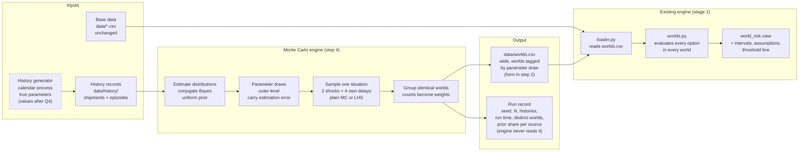

# Monte Carlo engine (stage 2) design

- **Status:** Living document. Step 1 (model design) is in progress. Each open question below is replaced by its decision when it is settled.
- **Branch:** `feature/extension-stage2-ian`, created from `feature/extension-trial-ian` at 34a7f78.
- **Decision owner:** Sunghyuk (Ian) Yoon
- **Last updated:** 2026-11-13

## 1. Purpose

Stage 1 gave the receipt date of PO01 fixed weights from a triangular rule (ADR 0002).
Stage 2 replaces those weights with a Monte Carlo engine.
The engine samples possible situations, groups identical ones and writes them as weighted worlds.
The existing engine evaluates every option in every world exactly, as in stage 1.

The engine exists for one reason.
A single cause can delay several things at once.
If port or customs congestion delays PO01, it can delay the alternative supplier OF02 too.
ALT_BUY is then late exactly when it is needed.
Fixed weights on one variable cannot show this. A joint model of several variables can.

This document holds the structure, the equations, the decisions so far, the open questions and the references.

## 2. How we got here

| Date | Decision | Where it is recorded |
|---|---|---|
| 2026-09-28 | The main project is the supply chain recovery decision agent. Monte Carlo becomes a side track that is added once the main project works. | Team discussion |
| 2026-11-07 | Engine MVP on the team baseline data. `simulate()` takes a list of actions, not a scenario name. Results are checked against precomputed answers in `tests/expected/`. | `README.md`, commit history on `main` |
| 2026-11-09 | Extension plan in three stages. (1) Uncertain receipt date as data. (2) Monte Carlo creates the worlds. (3) Model refinement. | `docs/extension-plan.md` |
| 2026-11-09 | Design rules. The engine computes exactly where it can. Monte Carlo is used only where things cannot be counted. Time and cost are never merged into one score. The LLM never sets weights. | `docs/extension-plan.md` |
| 2026-11-11 | Stage 1 weights are integers from a triangular three-point estimate. | ADR 0002 |
| 2026-11-12 | Stage 1 answers use a code-built `world_risk` view with one checked LLM paragraph. | ADR 0003 |
| 2026-11-12 | Stage 1 is complete and frozen for team review (476 tests). Stage 2 starts on its own branch. | `docs/extension-plan.md` |
| 2026-11-12 | Monte Carlo output is one wide CSV. `world_overrides.csv` goes away. | Section 5, ADR 0004 (step 2) |
| 2026-11-12 | Three kinds of variables, so that shared causes exist. PO01 receipt date, OF02 lead time, transfer lane lead times. | Section 4.1 |
| 2026-11-12 | "More realistic" means limited history. Few records per source, synthetic but plausible. | Section 6 |
| 2026-11-12 | No neural acceleration in stage 2. | Section 5 |
| 2026-11-12 | Plain Monte Carlo, common random numbers and Latin hypercube sampling. Every summary number gets a standard error. | Section 5 |
| 2026-11-12 | Scale is split off as optional stage 2-1. | Section 8 |
| 2026-11-12 | Two shared causes (option B). Gateway congestion moves PO01 and OF02. Regional transport disruption moves LN01 and LN02. | Section 4.2 |
| 2026-11-12 | Shared causes are modelled as common shocks with a shared severity, not as a copula. | Sections 4.3 and 4.5 |
| 2026-11-12 | Shared causes are recorded in the history as episodes. Two history files under `data/history/`. | Section 6.1 |
| 2026-11-12 | History is generated as a calendar process that is richer than the estimator. One demo history is committed. The method is checked over many generated histories. | Sections 6.3 and 6.4 |
| 2026-11-13 | Estimation is Bayesian with conjugate priors and a uniform prior. Chosen by comparing six established methods on the engine itself. | Section 7 |
| 2026-11-13 | Parameter uncertainty enters by two-level sampling. Every summary number gets an interval. | Section 7.2 |
| 2026-11-13 | The view states the model assumptions and one threshold line per shared cause. No fixed stress scenario. | Section 7.6 |

## 3. Structure

Solid boxes are decided. Dashed boxes are open and name the question that settles them.

Two separate functions are kept on purpose.
"Make samples" and "evaluate one world" never share code.
Stage 2-1 can then swap the sampler or add an estimator without touching stage 2.
No code assumes that samples collapse into few worlds. Collapsing is an optimisation only.

The simulation window is defined in one place (step 3). Its end is set by Q4.

## 4. Model

### 4.1 Uncertain variables

| Symbol | Variable | Base value | Column in `worlds.csv` |
|---|---|---|---|
| $R$ | Receipt date of PO01 | Announced 2026-11-17 (planned 2026-11-11) | `purchase_order.PO01.receipt_date` |
| $L_O$ | Lead time of offer OF02 (S02, C01) | 3 days | `offer.OF02.lead_days` |
| $L_1$ | Lead time of lane LN01 (WH02 to WH01) | 2 days | `lane.LN01.lead_days` |
| $L_2$ | Lead time of lane LN02 (WH03 to WH01) | 4 days | `lane.LN02.lead_days` |

All values are whole days.
Every other value in the base data stays fixed.

### 4.2 Shared causes

| Cause | Moves | Story |
|---|---|---|
| $K_1$ Gateway congestion | $R$, $L_O$ | Port or customs backlog at the import gateway that both C01 suppliers use |
| $K_2$ Regional transport disruption | $L_1$, $L_2$ | Weather or a carrier shortage on the roads into WH01 |

The two causes are independent of each other.
A storm that triggers both is left as future work.

**Assumptions** (stated in the README when stage 2 ships)

1. S01 and S02 bring C01 in through the same import gateway.
2. One congestion episode covers the whole window, so OF02 (shipped 11-09) and PO01 (shipped after the repair) see the same backlog.
3. The announced date 11-17 reflects the equipment repair only. Gateway congestion comes on top of it.
4. Congestion and transport disruptions are recorded when they happen. Import shipments carry customs clearance times and carriers report delay reason codes, so this is not an artificial assumption.
5. A revised date announced after the repair is kept about as well as S01's ordinary promised dates. The own delay $E_R$ is estimated from S01's promise errors.

### 4.3 Equations

Each cause $k \in \{1, 2\}$ is a common shock.

$$S_k \sim \text{Bernoulli}(p_k), \qquad C_k \in \{1, 2, \dots\} \text{ with probability mass function } g_k$$

$S_k = 1$ means the cause occurs. $C_k$ is its severity in days.
Every variable exposed to cause $k$ is delayed by the same $S_k C_k$ days.
This is the shared severity. The same backlog delays everything that passes through it.

Each variable also has its own delay $E$ that no other variable shares.

$$
\begin{aligned}
R   &= d_{\text{ann}} + E_R + S_1 C_1 \\
L_O &= 3 + E_O + S_1 C_1 \\
L_1 &= 2 + E_1 + S_2 C_2 \\
L_2 &= 4 + E_2 + S_2 C_2
\end{aligned}
$$

$d_{\text{ann}}$ is the announced date 2026-11-17.
$E_R, E_O, E_1, E_2, S_1, C_1, S_2, C_2$ are mutually independent.
Their distributions are estimated from history (Q2, Q3).
Constraints from the base data still hold. $R$ is never before the planned date 11-11. Lead times stay at least 1 day.
Whether shipments skip weekends and holidays is decided in Q4.

One situation therefore needs eight random inputs.
With LHS each input gets its own stratified column.

### 4.4 Properties used in verification

**Covariance.** For two variables exposed to the same cause $k$,

$$\mathrm{Cov} = \mathrm{Var}(S_k C_k) = p_k \mathbb{E}[C_k^2] - p_k^2 \mathbb{E}[C_k]^2 .$$

Variables exposed to different causes have covariance zero.
Step 5 checks the sampled covariance against this value.

**Conditional probability.** $P(L_O \ge \ell \mid R \ge r)$ is a finite sum over $S_1$, $C_1$, $E_R$ and $E_O$.
It is computed exactly and compared with the sampled share.

**Special cases.**
$p_2 = 0$ gives option A (one cause only).
$p_1 = p_2 = 0$ gives independent variables, whose joint distribution is an exact convolution.
These are the known answers for step 5.
They are also the fallback. If the second cause cannot be estimated well, stage 2 ships with $p_2 = 0$ and states it.

### 4.5 Why a common shock and not a copula

Two ways to make the variables move together were compared.
A Gaussian copula ties the variables with one correlation $\rho$.
A common shock names the cause and adds its delay.

| Criterion | Common shock, shared severity | Gaussian copula |
|---|---|---|
| Joint delay in the extreme tail | Kept | Vanishes |
| Meaning of the parameters | "Congestion comes with probability $p$ and adds $C$ days" | $\rho$ has no direct physical meaning |
| Estimation from tens of records | $p$ and $C$ are estimated separately when the congestion state is recorded | 30 pairs with $\rho = 0.3$ give a 95% interval of about −0.07 to 0.60 (Fisher $z$) |
| Whole-day variables | No problem | Copula is not unique for discrete margins |
| Verification | Hand calculation and exact sums | Numerical integration |
| Advantage | Cause is explicit | Works without knowing the cause |

The tail row decides the matter.
A Gaussian copula with $|\rho| < 1$ has zero tail dependence (Embrechts, McNeil and Straumann 2002).
It therefore understates the case where everything is late together, which is the case this engine exists to show.

Illustration. Two continuous delays, each own delay exponential with mean 1, shock probability 0.2, shock severity exponential with mean 3. Both models have the same marginals and the same Spearman rank correlation. 2,000,000 samples, computed outside the repository.

| Top share $q$ | Common shock, severity drawn separately | Common shock, severity shared | Gaussian copula |
|---|---|---|---|
| 10% | 0.34 | 0.68 | 0.21 to 0.24 |
| 1% | 0.05 | 0.80 | 0.05 to 0.07 |
| 0.1% | 0.00 | 0.80 | 0.01 to 0.02 |

Each cell is the probability that one delay is in its top $q$ given that the other one is.
Drawing a separate severity per variable loses the tail just as the copula does.
That is why severity is shared.

### 4.6 What the shared cause changes in the results

Late orders per receipt date of PO01 and lead time of OF02, current engine at 34a7f78.

| ALT_BUY, OF02 lead | 11 | 12 | 13 | 14 | 15 | 16 | 17 | 18 | 19 | 20 | 21 |
|---|---|---|---|---|---|---|---|---|---|---|---|
| 3 days (stage 1) | 0 | 1 | 1 | 1 | 1 | 3 | 3 | 4 | 6 | 6 | 7 |
| 4 days | 0 | 1 | 3 | 3 | 3 | 5 | 5 | 6 | 8 | 8 | 9 |
| 5 days | 0 | 1 | 3 | 4 | 4 | 6 | 6 | 7 | 9 | 9 | 10 |
| 6 days | 0 | 1 | 3 | 4 | 5 | 7 | 7 | 8 | 10 | 10 | 11 |

One extra day for OF02 removes most of the gain of ALT_BUY.
At 6 days ALT_BUY equals WAIT.
WAIT and TRANSFER do not depend on OF02.

Late orders react almost additively to the two delays.
The expected value of a sum does not depend on how the parts are correlated.
So the shared cause barely moves expected late orders. It moves the tail and the conditional numbers.

Illustration with assumed parameters (not proposals). PO01 triangular with peak 11-16 without congestion and 11-19 with it, congestion probability 0.3, OF02 lead 3 or 4 days without congestion and 3 to 5 days with it. Same marginals in both columns.

| | Independent | Common shock |
|---|---|---|
| ALT_BUY expected late orders | 3.75 | 3.76 |
| ALT_BUY 90th percentile | 6 | 7 |
| HYBRID 90th percentile | 4 | 5 |
| P(OF02 at least 4 days given PO01 on or after 11-17) | 0.345 | 0.403 |

Consequence for the view (step 6). Expected values alone would hide the shared cause.
The view must show the 90th percentile and the conditional probability next to them.
With OF02 uncertain, ALT_BUY and TRANSFER come close in expected late orders (3.75 and 3.71 above), so the ranking itself can change.

## 5. Sampling and output (decided)

- **Sampling.** Plain Monte Carlo is the reference. Latin hypercube sampling (McKay, Beckman and Conover 1979) is the variance reduction shown, with error against sample count for both. Sobol quasi-Monte Carlo only if time remains (Niederreiter 1992).
- **Common random numbers.** Every option is evaluated on the same worlds. This is already how `engine/worlds.py` works (Glasserman 2003, ch. 4).
- **Standard errors.** Every summary number is reported with its standard error.
- **Fixed seed.** The seed is part of the run record.
- **Output.** `data/worlds.csv` with columns `world_id, weight, <target_type>.<target_id>.<field>, ...`, one row per distinct world. Weight is the number of samples that produced that world. Column names are checked against `_OPEN_KINDS`.
- **Run record.** Seed, sample count, histories used, run time and number of distinct worlds. The engine never reads it.
- **No neural acceleration.** One simulation takes about 0.1 ms and samples collapse into a few hundred distinct worlds, so there is nothing to accelerate. Neural Importance Sampling (Müller et al. 2019) was considered and rejected. Recorded in ADR 0004.
- **Dependencies.** Python standard library only unless decided otherwise.

## 6. History records (decided)

### 6.1 Files

The history lives in `data/history/`.
The loader of the main engine never reads it.
Keeping it under the data folder lets a separate data set (stage 2-1) carry its own history.

| File | Columns |
|---|---|
| `shipments.csv` | `shipment_id, source_id, ship_date, promised_date, receipt_date, episode_id` |
| `episodes.csv` | `episode_id, cause_id, start_date, end_date, delay_days` |

- `source_id` is one of OF01, OF02, LN01, LN02.
- `cause_id` is K1 (gateway congestion) or K2 (regional transport disruption).
- `episode_id` is empty for a shipment that met no episode.
- The own delay of a shipment is its lateness minus the delay of its episode. In days, `receipt_date - promised_date - delay_days`, with `delay_days` taken as 0 when there is no episode.

Episodes are recorded rather than hidden.
With hidden episodes every delay would have to be split into its own part and its shared part by a mixture model fitted with the EM algorithm (Dempster, Laird and Rubin 1977).
Tens of records are too few for that to be stable.
Recorded episodes let $p_k$ and $C_k$ be counted directly (assumption 4 in section 4.2).

### 6.2 Size

Twelve months before DAY0, 2025-11-09 to 2026-11-08.

| Source | Records | Reason |
|---|---|---|
| OF01 (S01 regular orders) | 12 | One order a month |
| OF02 (S02 alternative supply) | 6 | Used rarely. The thinnest source on purpose |
| LN01 | 15 | Transfers between warehouses are more frequent |
| LN02 | 10 | |
| K1 gateway congestion | 3 to 4 episodes | |
| K2 regional transport disruption | 4 to 5 episodes | Winter weather and similar |

The real limit is the episode count, not the shipment count.
Shipments inside one episode share its delay, so they are not independent observations of $C_k$.
The severity distribution of each cause rests on three to five numbers.

### 6.3 Generator

- **Calendar process.** Episodes of each cause start at random times on the twelve-month calendar, last a random number of days and carry a severity in days. Shipments are placed on the calendar by their schedule. A shipment in transit during an episode of a cause it is exposed to receives that episode's delay. Shipments of S01 and S02 in the same weeks therefore share the same congestion, as in reality.
- **Richer than the estimator, on purpose.** The generator has episode start times, durations and severities. The estimator in section 4.3 only knows whether a cause is active in the window ($S_k$) and how many days it adds ($C_k$). Real systems are always richer than the model used on them, so the mismatch is the honest test.
- **True parameters live only in the generator.** They define the synthetic world and are stated as such in the README. Real records would replace the generator, not the engine. Their values are set after Q3 and Q4. Where a verified public statistic gives a plausible scale it is used, otherwise the values are stated as chosen.
- **Fixed seed.** The demo history is committed, so nobody needs to rerun the generator to see the demo.
- **Upper challenge.** The generator also uses different distribution families from the estimator, and coverage (section 6.4) is checked again.

### 6.4 Checking the method over many histories

One history is one draw of luck.
A good result on one seed says little about the method.

The method is therefore checked over many generated histories, as in a standard simulation study (Morris, White and Crowther 2019).
For each history the engine estimates the parameters, runs the Monte Carlo and reports each summary number with its interval.
The true value of each number comes from the true process with a large sample.
Coverage is the share of histories whose interval contains the true value.
A 95% interval that covers the truth far less often than 95% of the time means the uncertainty is understated.
The number of histories is set in Q5. One evaluation of a world takes about 0.1 ms, so a few hundred histories are affordable.

## 7. Estimation (decided)

### 7.1 Method

Every input is estimated with a conjugate Bayesian model and a uniform (Bayes–Laplace) prior (Gelman et al. 2013, ch. 2).
Conjugate means the posterior has the same form as the prior, so every predictive distribution has a closed form.
The closed forms are ratios of gamma functions whose arguments differ by integers, so they are rational numbers and can be checked exactly with `Fraction`.

| Input | Model | Prior | Posterior |
|---|---|---|---|
| Episode rate $\lambda_k$ per year | $n$ episodes in one year, Poisson | flat | $\mathrm{Gamma}(n+1,\ 1)$ |
| Cause active in the window | $S_k$ Bernoulli with $p_k = 1 - e^{-\lambda_k w}$ | from $\lambda_k$ | $P(S_k = 1) = 1 - (1+w)^{-(n+1)}$ |
| Severity $C_k - 1$ | Geometric($\theta_k$) | $\mathrm{Beta}(1,1)$ | $\mathrm{Beta}(n+1,\ S+1)$, $S$ = sum of observed $C_k - 1$ |
| Own delay category (early, on time, late) | Categorical | $\mathrm{Dirichlet}(1,1,1)$ | $\mathrm{Dirichlet}$(counts + 1) |
| Days early minus 1, days late minus 1 | Geometric | $\mathrm{Beta}(1,1)$ | as for the severity |

$w$ is the exposure window in years. It is set in Q4.
The three-part own delay lets $R$ come before the announced date, as stage 1 allowed.
Every outcome keeps a positive probability even if the history never showed it (Cromwell's rule, Lindley 1985).

### 7.2 Two-level sampling

The outer level draws $M$ parameter sets from the posterior.
The inner level draws worlds for each parameter set.

- **Point value.** Pooled over all draws. This equals the posterior predictive value.
- **Interval.** The 5th to 95th percentile of the summary number across the $M$ parameter sets.
- **Two error sources reported apart.** Monte Carlo error shrinks with more samples. Estimation uncertainty shrinks only with more history (Corlu, Akcay and Xie 2020). Showing both makes the limit of the data visible.
- **Cost.** A world is evaluated once whatever the parameters, so the outer level adds bookkeeping, not simulation.
- **Format.** `worlds.csv` needs the parameter draw of each sample. The exact form is decided in step 2 (ADR 0004).

### 7.3 Comparison that chose the method

The question has a name in simulation research, input uncertainty (Corlu, Akcay and Xie 2020).
Six established methods were compared on the engine itself, following the simulation study design of Morris, White and Crowther (2019).

**Setup.** The engine's late order count was tabulated for every combination of the four variables (about 20,000 combinations, exact because late counts stop changing past the window).
240 histories of the decided size were generated from an illustrative true model.
Truth A uses the estimator's families. Truth B gives the delays a heavier tail from another family.
Each method reported a point value and a 90% interval for each option.
Computed outside the repository. Step 5 repeats it with the real generator.

Results as truth A / truth B.

| Method | RMSE of expected late orders | Coverage, expected late orders | Coverage, chance of no late order | Bias of P90 | ALT_BUY and TRANSFER in the right order |
|---|---|---|---|---|---|
| Plug-in (Law 2015) | 0.65 / 0.63 | no interval | no interval | −0.52 / −0.33 | 0.92 / 0.90 |
| Nonparametric bootstrap (Barton and Schruben 2001) | 0.67 / 0.63 | 0.83 / 0.85 | 0.30 / 0.32 | −0.43 / −0.27 | 0.89 / 0.92 |
| Parametric bootstrap (Cheng and Holland 1997) | 0.65 / 0.63 | 0.82 / 0.83 | 0.67 / 0.63 | −0.52 / −0.33 | 0.92 / 0.90 |
| **Bayes, uniform prior** (Chick 2001) | **0.53 / 0.52** | **0.90 / 0.90** | 0.96 / 0.93 | −0.21 / +0.01 | **0.98 / 0.97** |
| Bayes, Jeffreys prior (Jeffreys 1946) | 0.58 / 0.57 | 0.88 / 0.89 | 0.94 / 0.90 | −0.19 / +0.03 | 0.96 / 0.94 |
| Bayesian model averaging (Chick 2001, Hoeting et al. 1999) | 0.54 / 0.51 | 0.88 / 0.90 | 0.97 / 0.95 | −0.21 / +0.02 | 0.98 / 0.97 |

The Monte Carlo error of a coverage value is about ±0.02.
Bootstrap intervals labelled 90% cover 82 to 85% of the time, and the bootstrap cannot produce an outcome the history never showed.
The uniform-prior Bayes method has the lowest error, nominal coverage and the best ordering of the two close options, also under the wrong family (truth B).

### 7.4 Known weaknesses

The same setup was rerun under conditions chosen to hurt the method. 160 histories each. Coverage of expected late orders, RMSE in brackets.

| Method | Base | Thin data (half the records) | Shift (window worse than the past year) | Dependent records |
|---|---|---|---|---|
| Parametric bootstrap | 0.82 (0.62) | 0.81 (0.76) | 0.23 (1.43) | 0.60 (0.91) |
| Bayes, uniform prior | 0.89 (0.50) | 0.95 (0.51) | 0.23 (1.34) | 0.74 (0.71) |
| Bayes, Jeffreys prior | 0.90 (0.56) | 0.91 (0.63) | 0.28 (1.36) | 0.70 (0.80) |

Weaknesses of the method itself.

1. **The prior weighs more where data are thin.** The uniform prior acts like added pseudo-records. Three for the category shares, one episode per year for the rate. That is 33% of the weight for OF02 (6 records) and 20% for OF01 (12 records). It makes intervals wider, not wrong. Thin data gave 0.95 coverage against a nominal 0.90.
2. **Uniform is not the same as no information.** A uniform prior on $\theta$ is not uniform on the mean delay. It puts 10% prior mass on a mean delay above 9 days (Kass and Wasserman 1996). It matters only where a category has no records.
3. **Unrepresentative histories.** Histories that happened to show 0 or 1 gateway episode under a true rate of 4 per year covered 0.77 of the time (13 cases, indicative only).
4. **Implementation cost.** Two-level sampling changes the output format and adds tests.

Weaknesses that no compared method removes.

5. **Non-stationarity.** If the window is worse than the past year, every method covers about a quarter of the time. Assumption 5 (revised promise kept like an ordinary one) is a risk of this kind.
6. **Dependent records.** If a source has good and bad periods, its records are not independent and every interval is too narrow.

The answer to 5 and 6 is not a different estimator. It is stating the assumptions and showing where the decision would flip (section 7.6).

### 7.5 Considered and not adopted

| Method | Reason |
|---|---|
| Jeffreys prior | Higher error than uniform and too conservative for the thinnest source. Kept as the comparison in the coverage check. |
| Bayesian model averaging over families | No gain in the comparison. With 3 to 5 episodes the family weights are set by the prior. |
| Partial pooling across sources (hierarchical model) | Only two suppliers and two lanes. The variance between groups cannot be estimated (Gelman 2006). |
| Delta method | Relies on a normal approximation that fails for few discrete records. |
| Metamodel-assisted bootstrap (Barton, Nelson and Xie 2014) | Built for expensive simulations. One world takes about 0.1 ms here. Candidate for stage 2-1. |
| Robust optimisation | Answers a different question, the worst case within a set. Future work. |
| Extreme value theory | Needs many tail observations. 3 to 5 episodes are too few. |
| Improved bootstrap intervals | Only the percentile interval was tested. No bootstrap variant creates outcomes beyond the records. |

### 7.6 What the view shows because of this

- **Assumptions on screen.** One or two lines in the view and the full list in the README. The past twelve months represent the window. Records are independent. S01 and S02 use the same import gateway. A revised date is kept like an ordinary promise.
- **One threshold line per shared cause.** Instead of a fixed stress scenario, the view states where the ranking of two adjacent options flips as $p_k$ grows, next to the current estimate (threshold analysis, Pauker and Kassirer 1980, Clemen and Reilly 2014). In the illustrative model ALT_BUY stays ahead of TRANSFER only while gateway congestion in the window is below about 52%, against an estimate of 21%. The threshold is computed with the other parameters at their point values and moves one parameter at a time. Both limits are stated with it.
- **Prior share per source in the run record.** Shows where results lean on the prior more than on data.
- **P90 next to the expected value.** In the illustrative model ALT_BUY is better than TRANSFER on average (5.40 against 6.19 late orders) and worse in the tail (P90 10 against 9).

## 8. Open questions

| # | Question | What it settles |
|---|---|---|
| Q4 | How late dates can get | Upper tail of $R$ and the lead times, the weekend and holiday rule, the new end of the window, the exposure window $w$ and the scale of the true parameters. |
| Q5 | Sample count and error target | Default $N$, number of parameter draws $M$, the error target for each reported number, the LHS comparison grid and the number of histories for the coverage check. |

## 9. How stage 2 proceeds

### Steps

| # | Step | Notes |
|---|---|---|
| 1 | Model design | This document. Q1 to Q3 decided. Q4 and Q5 remain. |
| 2 | Format change | Wide single CSV, loader rewrite, ADR 0004. Stage 1 results must come out identical in the new format. |
| 3 | Window separation | One place defines the window, up to the end from Q4. Today it lives in `loader.py` (`HORIZON_DAYS`, worlds block), `evaluate.py` (`HORIZON_ISO`) and `simulate.py` (window check). Remove the dead line `DAY0.replace(day=DAY0.day + HORIZON_DAYS)`, which fails past November 30. |
| 4 | Monte Carlo engine | Samples, grouping, weights, one file. Location of the module is decided here. |
| 5 | Verification | See section 10. |
| 6 | Open the new kinds | `offer.lead_days` and `lane.lead_days`. The what-if table varies one variable at a time with the others at base values. View shows the tail and conditional numbers (section 4.6), the assumptions and the threshold line (section 7.6). |
| 7 | Cleanup | Delete `scripts/stage1_triangular_worlds.py` and its test, mark ADR 0002 superseded, update docs, real sweeps, fixtures. |

Target is stage 2 done around 11-18. The deadline with the demo video is 11-22.

### Routine for every step

1. Decisions are taken one at a time, and work stops where a decision is needed.
2. Each code step gets a prompt for IBM Bob, the expected values computed in advance and a way to confirm the step is done.
3. Code is written in IBM Bob, in a new Bob task for stage 2. Documents are written outside Bob.
4. Before a commit, the change is read in the working folder and the full test suite is run.
5. After a push, the branch is checked again on GitHub.

### Stage 2-1. Scale (optional upper challenge)

- **Gate.** Starts only if stage 2 is done and verified with about three working days left before 11-22. Otherwise it goes to future work in the README with the design below.
- **Scope.** A separate, larger synthetic data set in its own folder. The default `data/` and its tests stay untouched.
- **Experiment.** Same error target, compare run time and error for plain Monte Carlo, LHS and multifidelity Monte Carlo with a surrogate as a control variate (Peherstorfer, Willcox and Gunzburger 2016, 2018). The surrogate only saves exact runs and never sets the reported number.
- Touches the engine owner's validation, so it is agreed with the team first.

## 10. Verification plan (step 5)

| Check | Known answer |
|---|---|
| Independent case ($p_1 = p_2 = 0$) | Exact convolution of the own-delay distributions. Sampled weights converge to it within a tolerance, fixed seed. |
| Shared cause creates correlation | Sampled covariance against $p_k \mathbb{E}[C_k^2] - p_k^2 \mathbb{E}[C_k]^2$. Covariance across the two causes is zero. |
| Conditional probability | Exact finite sum (section 4.4) against the sampled share. |
| Estimator recovers the truth | Parameters estimated from the demo history against the generator's true parameters, within the stated uncertainty. |
| Interval coverage | Share of many generated histories whose interval contains the true value, against the nominal level (section 6.4). |
| Method comparison | The table of section 7.3 repeated with the real generator. |
| Prior sensitivity | Uniform against Jeffreys prior on the demo history, reported side by side. |
| Threshold | The threshold of section 7.6 against a direct evaluation just below and just above it. |
| Stage 1 regression | Stage 1 worlds in the new format give the ADR 0002 table exactly. |
| Error shrinks with $N$ | Standard error falls roughly as $1/\sqrt{N}$ for plain Monte Carlo. |
| LHS against plain | Error against $N$ for both, same seed set. |

## 11. References

Each reference is listed with the reason it is treated as verified.

- N. Metropolis, S. Ulam, "The Monte Carlo Method," *Journal of the American Statistical Association* 44(247), 335–341, 1949. [doi:10.1080/01621459.1949.10483310](https://doi.org/10.1080/01621459.1949.10483310)
  Founding paper of the method.
- P. Glasserman, *Monte Carlo Methods in Financial Engineering*, Springer, 2003. [doi:10.1007/978-0-387-21617-1](https://doi.org/10.1007/978-0-387-21617-1)
  Standard graduate textbook. Variance reduction including common random numbers and control variates, quasi-Monte Carlo, and factor models for dependent defaults.
- M. D. McKay, R. J. Beckman, W. J. Conover, "A Comparison of Three Methods for Selecting Values of Input Variables in the Analysis of Output from a Computer Code," *Technometrics* 21(2), 239–245, 1979. [doi:10.1080/00401706.1979.10489755](https://doi.org/10.1080/00401706.1979.10489755)
  Origin of Latin hypercube sampling. Cited thousands of times.
- H. Niederreiter, *Random Number Generation and Quasi-Monte Carlo Methods*, SIAM, 1992. [doi:10.1137/1.9781611970081](https://doi.org/10.1137/1.9781611970081)
  Standard text on quasi-Monte Carlo.
- B. Efron, "Bootstrap Methods: Another Look at the Jackknife," *Annals of Statistics* 7(1), 1–26, 1979. [doi:10.1214/aos/1176344552](https://doi.org/10.1214/aos/1176344552)
  Origin of the bootstrap. Among the most cited papers in statistics.
- A. W. Marshall, I. Olkin, "A Multivariate Exponential Distribution," *Journal of the American Statistical Association* 62(317), 30–44, 1967. [doi:10.1080/01621459.1967.10482885](https://doi.org/10.1080/01621459.1967.10482885)
  Origin of the common shock model. Cited thousands of times and standard in reliability and insurance texts.
- P. Embrechts, A. McNeil, D. Straumann, "Correlation and Dependence in Risk Management: Properties and Pitfalls," in M. Dempster (ed.), *Risk Management: Value at Risk and Beyond*, Cambridge University Press, 176–223, 2002. [doi:10.1017/CBO9780511615337.008](https://doi.org/10.1017/CBO9780511615337.008)
  Shows that a Gaussian copula has zero tail dependence. Cited thousands of times and a standard reference in risk management.
- A. J. McNeil, R. Frey, P. Embrechts, *Quantitative Risk Management*, revised ed., Princeton University Press, 2015.
  Standard graduate textbook covering copulas, tail dependence and common shock models.
- C. Genest, J. Nešlehová, "A Primer on Copulas for Count Data," *ASTIN Bulletin* 37(2), 475–515, 2007. [doi:10.2143/AST.37.2.2024077](https://doi.org/10.2143/AST.37.2.2024077)
  Review in a leading actuarial journal on why copulas are not unique for discrete data. Widely cited.
- R. B. Nelsen, *An Introduction to Copulas*, 2nd ed., Springer, 2006. [doi:10.1007/0-387-28678-0](https://doi.org/10.1007/0-387-28678-0)
  Standard textbook on copulas. Cited only to describe the rejected option.
- A. P. Dempster, N. M. Laird, D. B. Rubin, "Maximum Likelihood from Incomplete Data via the EM Algorithm," *Journal of the Royal Statistical Society, Series B* 39(1), 1–38, 1977. [doi:10.1111/j.2517-6161.1977.tb01600.x](https://doi.org/10.1111/j.2517-6161.1977.tb01600.x)
  Standard method for estimation with hidden variables. Among the most cited papers in statistics. Cited only to explain why episodes are recorded rather than hidden.
- T. P. Morris, I. R. White, M. J. Crowther, "Using Simulation Studies to Evaluate Statistical Methods," *Statistics in Medicine* 38(11), 2074–2102, 2019. [doi:10.1002/sim.8086](https://doi.org/10.1002/sim.8086)
  Tutorial on evaluating a method over many generated data sets, including coverage. Cited thousands of times and used as the standard guide for simulation studies.
- R. A. Fisher, "Frequency Distribution of the Values of the Correlation Coefficient in Samples from an Indefinitely Large Population," *Biometrika* 10(4), 507–521, 1915. [doi:10.2307/2331838](https://doi.org/10.2307/2331838)
  Origin of the $z$ transformation used for the interval on $\rho$. Taught in every statistics curriculum.
- D. V. Lindley, *Making Decisions*, 2nd ed., Wiley, 1985.
  Standard textbook of Bayesian decision analysis. Source of Cromwell's rule (no zero probability for a possible event), already used in `docs/extension-plan.md`.
- For stage 2-1 only. B. Peherstorfer, K. Willcox, M. Gunzburger, "Optimal Model Management for Multifidelity Monte Carlo Estimation," *SIAM Journal on Scientific Computing* 38(5), A3163–A3194, 2016. [doi:10.1137/15M1046472](https://doi.org/10.1137/15M1046472) And "Survey of Multifidelity Methods in Uncertainty Propagation, Inference, and Optimization," *SIAM Review* 60(3), 550–591, 2018. [doi:10.1137/16M1082469](https://doi.org/10.1137/16M1082469)
  Top applied mathematics journals, widely cited.
- C. G. Corlu, A. Akcay, W. Xie, "Stochastic Simulation under Input Uncertainty: A Review," *Operations Research Perspectives* 7, 100162, 2020. [doi:10.1016/j.orp.2020.100162](https://doi.org/10.1016/j.orp.2020.100162)
  Open-access review of the field. Used as a map of the method families, while each method is cited from its original paper.
- S. E. Chick, "Input Distribution Selection for Simulation Experiments: Accounting for Input Uncertainty," *Operations Research* 49(5), 744–758, 2001. [doi:10.1287/opre.49.5.744.10606](https://doi.org/10.1287/opre.49.5.744.10606)
  Founding paper of Bayesian input modelling, including model averaging. Leading operations research journal.
- F. Zouaoui, J. R. Wilson, "Accounting for Parameter Uncertainty in Simulation Input Modeling," *IIE Transactions* 35(9), 781–792, 2003. And "Accounting for Input-Model and Input-Parameter Uncertainties in Simulation," *IIE Transactions* 36(11), 1135–1151, 2004.
  Standard papers on Bayesian treatment of parameter and family uncertainty in simulation. Widely cited.
- W. Xie, B. L. Nelson, R. R. Barton, "A Bayesian Framework for Quantifying Uncertainty in Stochastic Simulation," *Operations Research* 62(6), 1439–1452, 2014. [doi:10.1287/opre.2014.1316](https://doi.org/10.1287/opre.2014.1316)
  Bayesian intervals for simulation output under input uncertainty. Leading operations research journal.
- R. R. Barton, L. W. Schruben, "Resampling Methods for Input Modeling," *Proceedings of the 2001 Winter Simulation Conference*, 372–378, 2001. [PDF](https://informs-sim.org/wsc01papers/048.PDF)
  Standard reference for the nonparametric bootstrap of input data, from the main conference of the field.
- R. C. H. Cheng, W. Holland, "Sensitivity of Computer Simulation Experiments to Errors in Input Data," *Journal of Statistical Computation and Simulation* 57(1–4), 219–241, 1997.
  Origin of the parametric bootstrap and delta method for input uncertainty. Widely cited.
- R. R. Barton, B. L. Nelson, W. Xie, "Quantifying Input Uncertainty via Simulation Confidence Intervals," *INFORMS Journal on Computing* 26(1), 74–87, 2014.
  Metamodel-assisted bootstrap. Cited only for the method not adopted.
- J. A. Hoeting, D. Madigan, A. E. Raftery, C. T. Volinsky, "Bayesian Model Averaging: A Tutorial," *Statistical Science* 14(4), 382–417, 1999. [doi:10.1214/ss/1009212519](https://doi.org/10.1214/ss/1009212519)
  Standard tutorial on model averaging. Cited thousands of times.
- H. Jeffreys, "An Invariant Form for the Prior Probability in Estimation Problems," *Proceedings of the Royal Society A* 186(1007), 453–461, 1946. [doi:10.1098/rspa.1946.0056](https://doi.org/10.1098/rspa.1946.0056)
  Origin of the Jeffreys prior and of the invariance argument against uniform priors.
- R. E. Kass, L. Wasserman, "The Selection of Prior Distributions by Formal Rules," *Journal of the American Statistical Association* 91(435), 1343–1370, 1996. [doi:10.1080/01621459.1996.10477003](https://doi.org/10.1080/01621459.1996.10477003)
  Review of rule-based priors including uniform and Jeffreys. Widely cited.
- A. Gelman, "Prior Distributions for Variance Parameters in Hierarchical Models," *Bayesian Analysis* 1(3), 515–534, 2006. [doi:10.1214/06-BA117A](https://doi.org/10.1214/06-BA117A)
  Why few groups do not support a hierarchical variance. Cited thousands of times.
- S. G. Pauker, J. P. Kassirer, "The Threshold Approach to Clinical Decision Making," *New England Journal of Medicine* 302(20), 1109–1117, 1980. [doi:10.1056/NEJM198005153022003](https://doi.org/10.1056/NEJM198005153022003)
  Standard paper on reporting the threshold where a decision flips. Cited thousands of times.
- R. T. Clemen, T. Reilly, *Making Hard Decisions*, 3rd ed., Cengage, 2014.
  Standard decision analysis textbook. Sensitivity and threshold analysis.
- A. M. Law, *Simulation Modeling and Analysis*, 5th ed., McGraw-Hill, 2015.
  Standard simulation textbook. Fitting input distributions by plug-in estimates.
- Considered and not used. T. Müller, B. McWilliams, F. Rousselle, M. Gross, J. Novák, "Neural Importance Sampling," *ACM Transactions on Graphics* 38(5), 145, 2019. [doi:10.1145/3341156](https://doi.org/10.1145/3341156)
- A. Gelman, J. B. Carlin, H. S. Stern, D. B. Dunson, A. Vehtari, D. B. Rubin, *Bayesian Data Analysis*, 3rd ed., CRC Press, 2013.
  Standard textbook, cited tens of thousands of times. Chapter 2 covers the conjugate models and posterior predictive distributions used in section 7.1.

Weight rule references for stage 1 (Jaynes 1957, Malcolm et al. 1959, Garthwaite, Kadane and O'Hagan 2005, Law 2015) are in ADR 0002.
